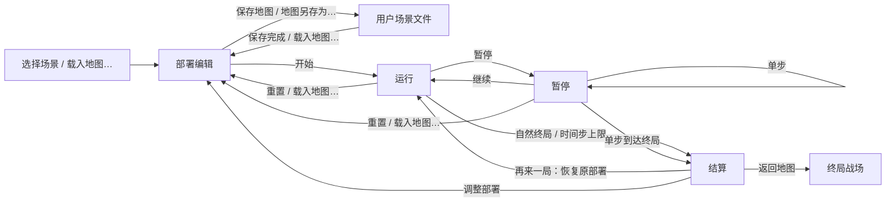

# 优化工作流与验收清单

本文依据《UAV_WarGame v1.0 课程验收版优化设计方案》整理本轮工作流程、实现对应和验收方法。2026-10-11 的最新本地全量测试为 **397 项通过、1 条警告**，源码流程自检与最终正式 EXE 的本机自检均通过。自动测试、界面截图与人工验收分别记录；“自动通过”不表示真实鼠标操作、全部显示缩放或干净 Windows 交付验收已通过。

证据见 [pytest 结果](verification/pytest-results.xml)、[源码流程自检](verification/source-smoke.json)、[正式 EXE 本机自检](verification/package-smoke.json)、[1280×720 部署截图](verification/deployment-1280x720.png)、[1366×768 部署截图](verification/deployment-1366x768.png) 与 [上限平局原因截图](verification/step-limit-1280x720.png)。最终程序由构建生成至 `dist/UAV_WarGame.exe`，源码仓库不提交 EXE，获取方式见 [README 构建说明](../README.md#测试与打包)。重建后已确认内置六个地图/帮助/结果/详情 QML、两张地图 PNG、来源 JSON 及五个场景 JSON 共 14 个资源与当前源码一致；正式程序自检为 `ok=true`、`frozen=true`，九组检查全通过且进程退出码为 0。无 Python 的独立 Windows 机器验收仍待执行。

## 1. 目标与实施边界

目标是让用户通过图形界面完成“选择场景 → 编辑部署 → 保存 → 运行和观察 → 查看结算 → 再次运行”的完整过程，并能在 Windows 电脑上完成持久化保存和课程演示。

- 保持 Python、PySide6/QML、现有五种单位和 JSON 场景技术栈。
- 优先处理核心状态、通信延迟、统计、补给和数据保存问题，再补齐单位详情、结算和场景管理。
- 以 PySide6/QML 作为主要交付入口；Pygame 兼容入口保持对应操作语义一致。
- 不扩大到三维、强化学习、分布式、账户或数据库功能。

优先级约定：P0 表示影响数据、仿真正确性或主要操作闭环；P1 表示直接影响操作体验和验收展示；P2 表示可在主要闭环通过后完成的增强项。优化方案中“非常高”的结算反馈在本清单中归为 P0。

## 2. 用户工作流

| 阶段 | 用户操作 | 应有反馈及下一步 | 优先级 | 状态 |
|---|---|---|---|---|
| 启动与场景选择 | 启动软件，选择标准对抗、障碍环境、自定义场景、山区河谷或河谷城镇 | 场景名称和地图内容清晰可见；进入可编辑部署阶段 | P1 | 五场景 API 与源码自检通过；鼠标切换待人工 |
| 地图浏览 | 滚轮或顶部按钮缩放，中键平移，小地图点击或拖动定位；开关网格/地标/全部范围 | 保持正确世界坐标，适应地图可恢复全图；浏览不改变单位与通行约束 | P1 | 原图加载、Qt 滚轮/鼠标事件及两种窗口控件边界通过；真实桌面待人工 |
| 编辑部署 | 选择单位并部署，创建、拖动、缩放或删除障碍物 | 有效编辑立即显示；非法部署说明原因；删除、清空提供合适确认 | P1 | 部署回归测试通过；真实拖动及确认待人工 |
| 保存或另存为 | 将编辑结果保存至当前自定义文件，或指定新文件名 | 显示实际文件名、成功或失败原因；覆盖已有文件时确认 | P0 | 保存、另存及中文路径自动通过；对话框确认待人工 |
| 加载与切换 | 选择其他预设或用户文件 | 加载成功后同步地图和场景信息；失败时说明原因并保留当前场景或运行 | P0 | 校验、成功加载和失败保留现态自动通过 |
| 仿真控制 | 开始、暂停、单步、继续，直接选择 1×、2×、4×或快速计算 | 运行状态与时间步同步；控制可用性明确；快速计算说明观察效果 | P1 | 控制 API、Qt 定时及快速计算自动通过；鼠标待人工 |
| 单位详情 | 点击战场中的单位 | 地图选中高亮、探测范围和详情联动；状态、生命值和弹药随仿真更新 | P1 | Qt 选择及详情刷新自动通过；地图联动效果待人工 |
| 日志与统计 | 观察统计，展开和筛选事件日志 | 攻击与命中含义明确；日志分类与内容一致；可追溯关键变化 | P1 | 攻击/命中统计自动通过；筛选交互待人工 |
| 结束结算 | 等待仿真达到自然终局或 2000 时间步上限 | 自动呈现胜负、结束原因、总时间步及双方统计；提供“返回地图”“再来一局”“调整部署”“导出战报…” | P0 | 红/蓝/平局 QML 结算及上限原因自动通过；鼠标操作待人工 |
| 返回地图 | 点击结算页“返回地图”，查看终局战场 | 保留本次结果和终局状态，方便检查对象及事件；同一轮关闭后不自动重复弹出 | P1 | 关闭不重复弹出与新局再弹出自动通过；鼠标查看待人工 |
| 再来一局 | 点击结算页“再来一局”，重复演示同一部署 | 恢复本次运行的初始部署；清除上一轮结果、日志、时间步和选中状态后开始新一轮 | P0 | 控制器、Qt 和源码自检通过；新增旧选择清理回归通过；连续演示待人工 |
| 调整部署 | 点击结算页“调整部署”，或执行重置 | 恢复开跑前的可编辑部署；完成修改后可保存并开始新的运行 | P0 | 恢复初始部署自动通过；图形界面编辑待人工 |
| 关闭与交付 | 关闭软件，再启动加载已保存场景；在干净 Windows 环境运行交付包 | 用户场景仍可找到、加载；交付程序和操作文档相符 | P0 | 源码恢复及最终 EXE 本机自检通过；真实重启与独立机器待核验 |

### 2.1 阶段转换与数据约定

以下约定已在控制器实现，并有对应回归测试；界面操作仍需按验收用例实测：

- “保存地图”写入 `current_save_path`。没有当前用户文件时，控制器默认保存到用户场景目录中的 `saved_map.json`；通过“地图另存为…”可以指定文件名。五个内置预设禁止覆盖。
- “地图另存为…”将新路径设置为后续保存目标。覆盖确认和取消行为属于界面验收，不由底层 `save_map(path)` 自动弹窗。
- 用户场景默认目录为 `%LOCALAPPDATA%\UAV_WarGame\scenarios`；非 Windows 使用对应平台用户数据目录。测试或离线自检可设置 `UAV_WARGAME_DATA_DIR`，场景存入该根目录下的 `scenarios`。
- 保存采用同目录临时文件和原子替换，保留当前地形、地图、基地、障碍及单位部署。运行中保存使用开跑前部署，不保存受损后的位置或基地状态。
- 运行、暂停或结束阶段“重置”恢复本轮开跑前的部署，保留开始前的编辑；部署阶段“重置”恢复当前已加载场景的初始部署，不回到固定标准预设。
- “再来一局”恢复开跑前部署并立即开始新一轮；不会继承上一轮伤害、日志、时间步或选中单位。未曾开始的部署则按当前编辑内容执行开始校验。
- “返回地图”保留终局供观察；“调整部署”进入可编辑阶段；“再来一局”开启新的一轮。五个入口含义不同。
- 成功场景切换、重置和重跑后，Qt 同步清理选中单位和旧详情；加载失败保留原场景、运行及选择。
- 加载会先完整校验结构、有限数值、边界、阵营、类型和 ID，再替换当前状态。保存失败不会更新当前保存路径。
- 编辑命令仅在部署阶段允许。快速计算使用有时间预算和批次上限的 Qt 刷新，暂停后停止继续推进。
- 结果仅在仿真结束后导出 JSON，非 `.json` 扩展名会补正；导出包含场景、统计、单位终态及日志，攻击次数和命中次数分别记录。
- 为保证演示有明确结束，默认仿真最多推进 2000 个时间步。同一步的自然胜负优先于上限平局；因达到上限而结束时，`finish_reason` 明确说明原因并在结算视图显示。
- QML 按每轮终局展示结算：本轮自动弹出一次，关闭后继续查看战场不重复弹出；新一轮到达终局时再次弹出。红胜、蓝胜、平局分别覆盖单位全灭与基地终局路径。

### 2.2 实际按钮与语义对照

| 界面按钮或快捷入口 | 对应动作 | 用户可见结果 |
|---|---|---|
| “载入地图…” | 选择用户 JSON 文件，调用 `load_map(path)` | 成功载入后回到部署；失败保留当前场景或运行 |
| “保存地图” | 调用 `save_map()` | 保存至当前用户文件；无当前文件时使用默认用户保存路径 |
| “地图另存为…” | 选择新路径，调用 `save_map(path)` | 保存为新用户文件，后续“保存地图”使用该路径 |
| “返回地图” | 关闭本轮结算视图 | 展示终局战场，保留统计，不自动重复弹出本轮结算 |
| “再来一局” | 调用 `restart()` | 恢复原始部署并开始新一轮，清除旧选中单位和旧统计 |
| “调整部署” | 调用 `reset()` | 返回部署编辑，恢复开跑前部署后可继续修改 |
| “导出战报…” | 选择文件，调用 `export_result(path)` | 导出本次结束结果 JSON；运行未结束时不允许导出 |
| 底部“帮助”或 `F1` | 打开操作说明 | 查看部署、地图编辑、仿真控制、保存加载及结算操作 |

### 2.3 控制器与界面的实现接口

| 接口或字段 | 实际用途 | 验证 |
|---|---|---|
| `available_scenarios()`、`select_scene(id)` | 返回 `id/name/path`；内置 ID 为 `standard`、`obstacles`、`custom`、`valley`、`river_city`，同时列出用户场景 | 控制器及五场景自检通过 |
| `save_map(filepath=None)`、`load_map(filepath=None)` | 保存当前用户文件、另存为指定路径，或加载当前文件/默认用户文件；成功加载进入部署 | 控制器和 Qt 路径测试通过 |
| `reset()`、`restart()` | 恢复当前加载初态或开跑前部署；重跑清除旧轮次数据 | 控制器、Qt 和源码自检通过 |
| `set_speed(index)` | 直接选择速度，拒绝非法索引，最后一档标为快速计算 | 控制器和 Qt 定时测试通过 |
| `export_result(path)` | 只导出结束结果；自动补正 JSON 扩展名，禁止覆盖内置预设 | 控制器与源码自检通过 |
| `scenarios/current_scenario/current_save_path/speed_index` | 向界面同步场景目录、名称、保存文件和速度选择 | 快照可序列化及相关测试通过 |
| 单位 `speed/type_label/unit_type_label/status_label/domain_label/engagement_label` | 显示速度、中文兵种、状态、平台和交战阶段；保持兼容字段 | Qt 详情选择与刷新测试通过 |

### 2.4 地图显示与相机约定

- `Battlefield.map_style` 与 JSON 的 `map.style` 对应，取值为 `tactical`、`valley`、`river`；旧文件缺省为战术地图，非法值拒绝。`set_map_style()` 只在部署允许，背景选择保存后可恢复。
- `core/terrain_catalog.py` 提供背景、标题及地标，地标按世界宽高缩放；快照中的 `map.visual` 交给 `TerrainLayer.qml`。两张 PNG 原样复用“应用综合实验”素材，来源与哈希见 [地图说明](地图与素材说明.md)。
- 主地图把世界坐标统一转换为相机缩放和平移后的视口坐标。左键部署、对象拖动、范围绘制和单位选择使用同一换算；缩放支持 1–4 倍，滚轮保持光标所指世界点。中键拖动与部署左键分开处理。
- `MapOverview.qml` 显示地图、单位与当前视口，通过点击或拖动定位。视口平移限制在地图范围内，“适应地图”恢复全图。全图单位标签收起，选中、悬停或放大后显示。
- 背景图片不参与通行判定。实际规则继续使用现有矩形障碍与单位平台；新增两张 1200×800 场景各 14 单位、16 障碍，保留两处桥梁通路。Pygame 保持原有显示与导航范围。

### 2.5 界面信息层级

| 区域 | 应呈现的信息 | 状态 |
|---|---|---|
| 顶部 | 中文标题、运行状态和时间步 | 已生成界面截图；真实操作待人工 |
| 场景管理区域 | 场景选择、“载入地图…”“保存地图”“地图另存为…” | 场景和文件 API 自动通过；真实对话框操作待人工 |
| 战场 | 单位、障碍、基地，选中单位及探测范围 | 模型和渲染测试通过；高亮视觉待人工 |
| 右侧 | 部署工具、运行统计或单位详情，按当前阶段切换 | Qt 属性与详情自动通过；布局及点击待人工 |
| 底部控制栏 | 开始/暂停、单步、速度选择、重置及“帮助”；帮助也可按 `F1` 打开 | 控制接口自动通过；全部尺寸、缩放和鼠标操作待人工 |
| 事件日志 | 全部、侦察、状态、交战等筛选及展开操作 | 事件统计自动通过；分类筛选待人工 |
| 结算视图 | 胜负、结束原因、总时间步和双方统计；“返回地图”“再来一局”“调整部署”“导出战报…” | 三种结果与自动弹出生命周期 QML 测试通过；鼠标操作待人工 |

## 3. 工程优化与实施顺序

下表列出本轮实际涉及的代码与验证范围。完成状态按核心自动验证、界面人工验收和交付验收分别判断。

| 编号 | 工作项 | 实现对应 | 完成条件 | 优先级 | 状态 |
|---|---|---|---|---|---|
| O-01 | 校正历史发现记录、信息共享和状态锁生命周期 | `core/simulator.py`、`tests/test_workflow_core.py` | 离开探测范围、共享过期和锁到期均按规则更新 | P0 | 自动通过 |
| O-02 | 校正连续观察下的通信延迟交付 | `core/target_pool.py`、核心回归测试 | 连续观察保留首次交付时限，较近观察者可以提前交付 | P0 | 自动通过 |
| O-03 | 区分攻击发起与成功命中统计 | 仿真统计、控制器快照和界面模型 | 未命中只增加攻击数；成功命中分别增加攻击、命中及实际伤害 | P0 | 自动通过；界面口径展示待人工 |
| O-04 | 统一弹药补给上限 | 仿真补给、各兵种配置 | 五种单位均不超过各自配置上限，保持补给节奏 | P0 | 自动通过 |
| O-05 | 分离预设资源和用户场景存储 | `core/map_persistence.py`、`core/controller.py` | 用户目录、原子写入、地形保留及重建实例后加载 | P0 | 源码及最终 EXE 保存加载自检通过；真实关闭重启待核验 |
| O-06 | 统一两套前端的地图加载语义 | `pygame_main.py`、控制器、Qt 模型 | 加载后进入部署；编辑器关联新地图；重置保留当前加载场景 | P0 | 自动通过；两套界面操作待人工 |
| O-07 | 补齐结算、返回、重跑和修改部署闭环 | 控制器、`ui/qt_models.py`、QML | 三种胜负自动展示，关闭后不重复弹出，新局再次展示；恢复原部署 | P0 | 控制器、Qt、QML 及源码自检通过；鼠标入口待人工 |
| O-08 | 增加预设选择、自定义加载、保存和另存为交互 | 场景目录、加载器、持久化、Qt 文件接口 | 五个场景可加载，支持用户文件和中文路径，内置预设只读 | P1 | API 自动通过；对话框及覆盖确认待人工 |
| O-09 | 增加单位选择与详情联动 | `SimulationViewModel`、`UnitListModel`、QML | 点击选择、实时详情，成功切换场景或再来一局时清理旧选择 | P1 | Qt、QML 详情绑定及成功重跑清理选择自动通过；高亮与范围视觉待人工 |
| O-10 | 优化运行控制和高速刷新 | Qt 定时器、控制器和 QML | 直接变速、单步暂停、批次有界、时间预算耗尽让出刷新 | P1 | 自动通过；鼠标演示及体感响应待人工 |
| O-11 | 整理界面、日志和帮助 | `ui/qml/Main.qml` 及界面组件 | 布局可读、日志筛选准确，首次提示和帮助可操作 | P1 | 920×540/1280×720 控件边界及 1366×768 离屏截图检查通过；其余人工待执行 |
| O-12 | 补充回归测试和持续集成 | 核心、控制器、Qt、QML 回归测试与 GitHub Actions | 自动执行并留存结果，远端持续集成执行成功 | P1 | 本地 397 项通过、1 条警告；远端 CI 待验证 |
| O-13 | 核对打包和交付文档 | `UAV_WarGame.spec`、README、项目文档 | 实际输出产物、启动方式、测试基线和操作说明一致 | P0 | 最终 EXE 九组本机自检及内置主要 QML 一致性核验通过；独立环境待核验 |
| O-14 | JSON 结果导出 | `SimulationController.export_result()`、Qt 文件接口 | 仅结束后导出，数据与本次统计一致，保护内置资源 | P2 | 自动通过；文件对话框操作待人工 |
| O-15 | 保证演示有界结束并说明平局原因 | 仿真时间步上限、`finish_reason` 和 QML 结算 | 默认 2000 步结束，自然胜负优先，界面显示上限平局原因 | P0 | 上限回归及源码自检通过；真实完整演示待人工 |
| O-16 | 丰富地图素材与预设，保持当前核心结构 | `terrain_catalog.py`、场景加载/持久化、两张原图与两个新场景 | 五场景可用，背景可保存恢复，初始地面部署和两桥通路连通 | P1 | 17 项地图后端测试及四次有界运行通过；来源哈希一致 |
| O-17 | 地图导航与显示层优化 | `Main.qml`、`TerrainLayer.qml`、`MapOverview.qml` | 缩放/平移/小地图定位准确，部署和单位选择不因缩放错位 | P1 | 11 项地图 UI 测试及源码/EXE 自检通过；真实桌面待人工 |

按依赖关系分三步推进：

1. 稳定性基线：O-01～O-06 已有源码回归证据，保留本轮新增测试作为后续基线。
2. 用户闭环：控制器、Qt 与 QML 已有完整流程的自动证据，执行 O-07～O-11 的真实鼠标操作验收，并检查 O-15 的有界结束现场表现。
3. 交付验证：包含新局选择清理与地图增强的最终正式 EXE 已重建，并通过本机九组流程自检及主要 QML 资源一致性核验；继续补齐远端 CI、系统显示缩放、真实关闭重启、独立 Windows 和目标环境文档与操作核验。O-14 已提供 JSON 导出，继续检查文件对话框操作。

## 4. 验收用例

执行时应记录实际结果、环境和证据。“待验证”不能替代“通过”，无法执行的测试应说明限制。

| 用例 | 场景与操作 | 预期结果 | 优先级 | 状态 |
|---|---|---|---|---|
| A-01 | 启动程序并依次选择标准对抗、障碍环境、自定义场景、山区河谷、河谷城镇 | 五个入口可用，地图和场景信息正确，无上一场景残留 | P1 | API 与源码自检通过；鼠标待人工 |
| A-02 | 部署单位并编辑障碍物，尝试一次非法部署 | 正常编辑生效；非法操作给出明确原因，场景仍可继续使用 | P1 | 部署回归通过；真实拖动待人工 |
| A-03 | 对自定义场景首次保存，继续编辑后再次保存 | 文件名和保存路径清晰，两次保存均能恢复最新部署 | P0 | 控制器及中文路径自动通过；提示展示待人工 |
| A-04 | 另存为新文件，再选择已有文件名并取消覆盖 | 新文件可加载，取消覆盖不修改已有文件 | P0 | 新路径及内置资源保护自动通过；取消覆盖待人工 |
| A-05 | 保存场景后关闭软件，再启动并加载 | 单位、障碍及相关配置恢复；文件不依赖临时解包目录 | P0 | 重建实例、源码及最终 EXE 保存加载往返通过；真实关闭重启待核验 |
| A-06 | 加载不存在或格式错误的文件；模拟无法写入的位置 | 给出加载/保存错误原因，当前场景和运行保持可用 | P0 | 自动通过：非法结构、坏 JSON、缺失文件及写入失败 |
| A-07 | 用鼠标开始、暂停、单步和继续 | 暂停停止自动推进；单步只推进规定步数；状态与时间步一致 | P1 | 控制器、Qt 及源码自检通过；鼠标待人工 |
| A-08 | 依次选择 1×、2×、4×、快速计算，再暂停和重置 | 速度反馈清晰；快速计算有说明；暂停及重置仍有响应 | P1 | 索引校验、批次及时间预算自动通过；交互待人工 |
| A-09 | 运行中选中单位并观察生命值、弹药和状态变化 | 单位高亮、探测范围和详情同步，显示值与模型一致 | P1 | Qt 选择、刷新及 QML 详情绑定自动通过；高亮视觉待人工 |
| A-10 | 选中单位后加载其他场景、重置或点击“再来一局” | 不继续显示旧场景或旧轮次的单位详情；成功重跑清空旧局选中 ID | P1 | Qt 清理、失败保留选择及重跑新回归自动通过；界面待人工 |
| A-11 | 切换日志筛选并对照侦察、状态、交战事件 | 分类内容匹配；攻击次数和命中次数分别显示且口径正确 | P1 | 统计口径自动通过；日志筛选待人工 |
| A-12 | 使用可复现配置分别触发红胜、蓝胜和平局 | 自动显示对应结果，时间步和双方统计与最终仿真状态一致 | P0 | QML 三种结果 × 单位全灭/基地终局自动通过；鼠标待人工 |
| A-13 | 结算后点击“返回地图” | 可以检查终局地图和统计，同一轮不重复弹窗，新局再次自动展示 | P1 | QML 弹出生命周期自动通过；鼠标查看战场待人工 |
| A-14 | 结算后点击“再来一局”，再进行暂停、继续和结算 | 从本轮初始部署开始；选中单位、日志、时间步、损伤及结算统计正确重置 | P0 | 原部署重跑及旧选择清理自动通过；整轮连续演示待人工 |
| A-15 | 结算后点击“调整部署”，保存并再次开始 | 进入编辑阶段，新部署用于下一轮，原有保存操作仍可使用 | P0 | 恢复编辑初态与保存自动通过；界面编辑待人工 |
| A-16 | 连续执行加载 → 开始 → 暂停 → 重置 → 重跑至少 5 次 | 无明显异常、重复计时或跨轮统计残留 | P0 | 组合回归已过；完整操作 5 轮待人工 |
| A-17 | 设置目标被发现后离开探测范围的固定时间步场景 | 历史记录、共享信息和状态锁按设计有效期更新 | P0 | 自动通过：离开范围、共享过期及锁到期 |
| A-18 | 设置通信延迟并连续观察同一目标 | 信息在规定时间步交付，重复观察不无限延后交付 | P0 | 自动通过：首次时限保留及较近观察者提前交付 |
| A-19 | 对照命中和未命中的确定性事件检查统计 | 攻击发起数与命中数分别符合事件记录 | P0 | 自动通过：未命中和成功命中分别计数 |
| A-20 | 对各单位执行补给，覆盖满弹药和接近上限情形 | 补给结果均不超过对应配置最大弹药量 | P0 | 自动通过：五种单位上限及补给节奏 |
| A-21 | 两套前端加载同一 JSON 并执行对应重置操作 | 地图内容和操作语义一致，文档说明与实际行为相符 | P0 | 加载与恢复 API 自动通过；双界面演示待人工 |
| A-22 | 检查首次启动提示，点击底部“帮助”或按 `F1` 打开说明 | 教师可找到部署、障碍编辑、控制及保存加载的操作说明 | P1 | 待人工 |
| A-23 | 检查 1920×1080、1366×768、1280×720，覆盖 100%、125%、150% 缩放 | 单位标签、统计卡片、底部按钮无明显遮挡，文字可读、主要按钮可点击 | P1 | 920×540/1280×720 关键控件边界及 1366×768 离屏截图检查通过；1920×1080/系统缩放/点击待人工 |
| A-24 | 执行全量自动测试并检查持续集成结果 | 无失败；记录环境、测试命令、通过数量、警告和输出 | P1 | 本地 397 项通过、1 条警告；远端 CI 待验证 |
| A-25 | 在未配置 Python 的 Windows 环境启动正式交付程序 | QML、图标、中文、场景加载、运行、重跑和持久化均可用 | P0 | 最终 EXE 本机自检通过；无 Python 的独立机器待验证 |
| A-26 | 核对 README、需求、操作手册、测试报告和实际产物 | 启动命令、产物形态、操作步骤和测试基线一致，无个人绝对路径依赖 | P0 | 本清单已同步回归、实际按钮及最终 EXE 证据；本轮资料已同步；目标环境操作待核验 |
| A-27 | 导出一次结束结果 JSON 并核对 | 导出指标与本次结算一致；未结束时拒绝导出，取消和失败可正常返回 | P2 | 数据及结束限制自动通过；对话框取消/失败展示待人工 |
| A-28 | 让未分出自然胜负的仿真达到默认 2000 步；同时覆盖到达上限时自然终局 | 上限平局能结束并显示原因；同一步自然胜负优先，不误标平局 | P0 | 上限及优先级回归、源码自检和原因截图通过；现场完整运行待人工 |
| A-29 | 加载山区河谷与河谷城镇，检查地标、障碍和双方部署 | 两图 1200×800，各 14 单位、16 障碍；双方初始地面部署互达，两桥有净空 | P1 | 后端连通性/桥梁测试、源码和 EXE 场景与图片加载通过 |
| A-30 | 部署时切背景并保存加载，运行和暂停时尝试切背景 | 三种风格保存往返，旧 JSON 可加载；运行及暂停不改背景，切背景不改碰撞 | P0 | 后端与 Qt 保存、兼容及阶段限制自动通过 |
| A-31 | 滚轮缩放、按钮放大/缩小、中键拖动，再适应地图 | 缩放 1–4 倍且锚点正确；平移不编辑部署；适应恢复全图 | P1 | 真实 Qt 滚轮/中键事件及控件点击通过；真实桌面待人工 |
| A-32 | 放大后部署，暂停后小地图定位并点击单位 | 放置位置与世界坐标一致，定位和单位选择正确，无误编辑 | P0 | Qt 鼠标事件与模型坐标、所选 ID 对照通过 |
| A-33 | 检查五场景地图图层与正式 EXE 的素材完整性 | 原图可用，导航在窗口内；源码与 EXE 的 QML、地图、场景一致；显示切换不改仿真 | P0 | 两尺寸地图控件边界、截图与 12 资源逐字节核验通过；[三个开关鼠标验证](verification/map-layer-checks.json)通过 |

## 5. 交付检查与演示顺序

| 交付项 | 检查要求 | 状态 |
|---|---|---|
| Windows 程序及资源 | 实际打包输出形态与说明一致，可在独立 Windows 环境启动 | 最终 EXE 本机九组自检及内置主要 QML 一致性核验通过；独立机器待验证 |
| 五个演示场景 | 标准对抗、障碍环境、自定义、山区河谷、河谷城镇均可加载和运行 | 五场景在源码与最终 EXE 自检通过；现场演示待核验 |
| README 与运行说明 | 清楚区分源码运行和可执行程序启动方式，路径可移植 | 正式程序与自检证据已具备；本轮资料与实际源码、测试及产物已同步 |
| 简短操作手册 | 包含场景管理、部署编辑、控制、单位详情、结算及重跑 | 按真实鼠标流程待人工核验 |
| 测试报告与验证记录 | 区分自动测试、手工测试和未执行项目，有环境和结果证据 | pytest XML、源码/EXE 自检 JSON 和截图已留存；剩余验证待补 |
| 答辩演示 | 在目标显示环境完整演示主要闭环，可重复运行 | 投影及完整演示待人工 |

建议演示顺序为：双击启动（约 30 秒）→ 选择与编辑场景（约 1 分钟）→ 保存并重新加载（约 30 秒）→ 开始、暂停、单步和变速（约 2 分钟）→ 查看单位详情（约 1 分钟）→ 查看结算并重跑（约 1 分钟）→ 展示测试和交付产物（约 1 分钟）。参考时长不是实际执行记录。

## 6. 验证记录

后续仅根据实际执行结果更新状态；源码检查、自动测试、图形界面验证和独立机器验证分别记录，不能互相替代。

当前证据基线：最新全量本地测试 **397 项通过、1 条警告，命令输出耗时 9.49 秒**。原有测试为 219 项；流程优化新增 79 项，地图增强新增 28 项，时间与记录新增 71 项，累计新增 178 项。XML 套件耗时 9.439 秒，执行时间为 2026-10-11T00:00:52.605630+08:00（北京时间），失败、错误和跳过均为 0。警告来自 pygame 第三方依赖。历史地图版本为 326 项；当前回归另覆盖时间设置、侦察/共享、摧毁时刻、战术/结果、导出与自动保存。

| 日期 | 版本或提交 | 环境 | 用例编号 | 执行方式 | 实际结果 | 证据或限制 | 状态 |
|---|---|---|---|---|---|---|---|
| 2026-10-11T00:00:52.605630+08:00 | 时间与记录扩展源码 | 本地 Windows 源码环境 | A-01～A-39 的自动部分 | 全量 pytest 与核心/控制器/Qt/QML 回归 | 397 项通过、1 条警告；无失败、错误或跳过 | `verification/pytest-results.xml`；套件耗时 9.439 秒；新增时间与记录 71 项回归 | 自动通过 |
| 2026-10-11 | 本轮工作目录源码 | 源码运行，`frozen=false` | 地图素材/缩放/小地图、五场景保存加载、控制与详情、红胜结算导出、有界结束及平局原因、原部署重跑 | 源码流程自检 | 九组检查均通过，`ok=true` | `verification/source-smoke.json`；只证明源码流程，未证明打包程序 | 自检通过 |
| 2026-10-11 | 本轮工作目录源码 | QML 整合与离屏渲染 | A-12、A-13、A-23 的自动部分 | 真实仿真终局触发 QML，检查控件边界及截图 | 三种结果和弹窗生命周期、920×540/1280×720 控件边界、1366×768 离屏截图检查通过 | `verification/pytest-results.xml`、`deployment-920x540.png`、`deployment-1280x720.png`、`deployment-1366x768.png`；不等同系统缩放或鼠标操作 | 自动与离屏检查通过；人工待执行 |
| 2026-10-11 | 最终正式 `dist/UAV_WarGame.exe` | 本机 Windows 打包程序，`frozen=true` | 地图素材/缩放/小地图、五场景与持久化往返、开始/暂停/单步与详情、自动结算导出、有界结束及可见平局原因、原部署重跑及编辑 | 最终 EXE 流程自检与资源核验 | 九组检查均通过，`ok=true`，进程退出码 0；内置六个地图/帮助/结果/详情 QML、两张地图 PNG、来源 JSON 及五个场景 JSON 共 14 个资源与当前源码一致 | [package-smoke.json](verification/package-smoke.json)；本机验证，不替代无 Python 的独立机器、系统缩放或真实鼠标验收 | 最终 EXE 本机核验通过 |
| 2026-10-10 | 地图增强工作目录源码 | 本机 Qt 离屏、仿真内核 | A-29～A-33 | 地图回归、鼠标/滚轮事件、两新图各随机种子 42/7 运行 | 新增 28 回归通过；四次运行无异常，均 2000 步上限平局 | [地图运行记录](verification/map-scenario-runs.json)、[山区河谷](verification/map-valley-1280x720.png)、[放大地图](verification/map-zoom-1280x720.png)；不作为胜率或真实桌面验收 | 自动与离屏检查通过 |
| 待执行 | 最终交付源码或程序 | 目标电脑、教室投影及所需系统缩放 | A-02、A-04、A-11～A-13、A-16、A-22～A-26 等人工部分 | 鼠标操作、5 轮完整演示、独立 Windows、远端 CI | 待填写 | 不将本地自动测试结果填入这些验收项 | 待验证 |

## 时间设置与运行记录扩展

本节补充时间与运行记录版本的验收方法；上表及其链接证据已刷新至本轮版本。当前证据为 397 项回归、九组源码/EXE 自检及 14 个打包资源核对。

| 编号 | 操作 | 预期与验证 |
| --- | --- | --- |
| A-34 | 部署时改为每步 0.5 秒、100 步上限；暂停后改为 1 秒 | 后续步采用新时长，已有事件不重算；运行中禁用编辑，非法输入保留原值 |
| A-35 | 分别观察目标首次发现、丢失与共享 | 侦察按观察单位记录；共享排队、提前、实际到达及失效区分步数与时刻 |
| A-36 | 构造双方同步攻击，以及单位或基地摧毁 | 每个对象只记录一次摧毁时刻，同步阵亡不丢失有效击毁者，外部清零不虚构击杀归因 |
| A-37 | 对照真实状态变化及终局 | 单位行为、交战阶段、阵营态势和集火目标变化写入记录；结果唯一且包含统计 |
| A-38 | 查看超过 200 条的对局、筛选并导出 | 界面提示最近 200 条；保存与导出保留全量，类别依据结构化字段；17,037 条完整对局核验通过 |
| A-39 | 暂停、重跑、切场景、退出；模拟写入失败后恢复 | 每局独立文件，历史能重载；失败保留内存并重试；正常退出保存；快算周期保存按 50 步与 5 秒节流 |

新回归覆盖 A-34～A-39，Qt 事件与截图覆盖三种窗口尺寸。四组独立进程的固定种子对战状态、统计、结果及随机数状态与 PR 基线一致；报告为 [timing-parity.json](verification/timing-parity.json)。快速对局节流后完整运行检查约 1.84 秒，含七次导出约 4.26 秒。源码与 EXE 均验证时间设置、完整记录、摧毁时刻和历史保留。

操作及格式说明见 [时间设置与运行记录](时间设置与运行记录说明.md)，截图见 [时间设置](verification/timing-settings-920x540.png)、[运行记录](verification/records-1280x720.png)、[摧毁时刻](verification/destruction-records-920x540.png)。真实桌面与独立 Windows 电脑验收仍按原清单执行。
