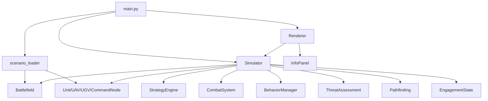
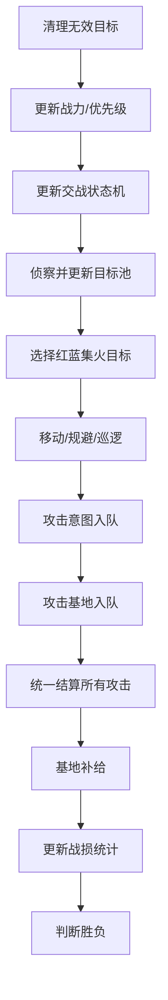
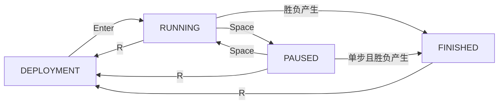

# 概要设计

## 系统总体架构

系统采用分层架构：

- `main.py`：程序入口，负责初始化、事件处理和主循环。
- `core`：核心业务逻辑，包括战场、单位、策略、战斗和仿真流程。
- `ui`：Pygame 可视化，包括地图渲染和信息面板。
- `data`：JSON 场景配置。
- `tests`：pytest 测试用例。
- `docs`：软件工程文档。

## 模块职责

- `core/battlefield.py`：地图边界、障碍物、地形和基地坐标。
- `core/entity.py`：实体基础属性和距离计算。
- `core/units.py`：统一 Unit 基类、平台类型和具体兵种。
- `core/unit_factory.py`：根据 JSON 中的 `unit_type` 创建单位。
- `core/strategy.py`：侦察、集火目标选择、巡逻、规避和撤退。
- `core/combat.py`：攻击条件、伤害结算、弹药消耗和攻击事件。
- `core/simulator.py`：统一调度每个时间步的仿真流程。
- `core/scenario_loader.py`：读取 JSON 并创建战场和单位对象。
- `core/deployment.py`：部署阶段管理，负责预设/手动部署和合法性检查。
- `core/behavior.py`：统一行为决策管理器，按优先级选取行为（攻击 > 规避 > 侦察 > 巡逻）。
- `core/threat.py`：威胁评估与战场态势感知（战力/态势/战术）。
- `core/pathfinding.py`：地面单位 Bug2 绕障算法与路径规划。
- `core/unit_config_loader.py`：读取 data/unit_config.json 兵种属性配置。
- `core/engagement.py`：简化交战状态机（SEARCH→REACTING→ATTACK→COOLDOWN），每单位独立维护反应延迟、攻击冷却和反先手机制。
- `ui/renderer.py`：绘制地图、基地、障碍物、单位、探测范围和攻击连线。
- `ui/panel.py`：绘制统计信息、目标池数量、集火目标和按键提示。

## 数据流说明

1. `main.py` 调用 `load_scenario()` 读取 `scenario_1.json`。
2. `scenario_loader` 创建 `Battlefield`，并通过 `UnitFactory` 创建单位列表。
3. `Simulator.step()` 按时间步更新目标池、集火目标、单位状态和战斗结果。
4. `Renderer.render()` 根据仿真状态绘制地图与信息面板。
5. 用户通过键盘控制暂停、单步、重置和退出。

## 单时间步仿真流程

1. 清理已摧毁单位和无效目标。
2. 更新战力/优先级。
3. 更新交战状态机（反应进度、冷却进度、目标丢失检测）。
4. 执行侦察，更新共享目标池，通知交战状态机发现目标。
5. 每个阵营选择集火目标。
6. 单位移动/规避/巡逻（行为决策管理器按优先级选取）。
7. 攻击阶段——检查交战状态，将攻击加入意图队列（不立即扣血）。
8. 攻击基地——同样受交战状态约束，加入意图队列。
9. 统一结算所有攻击意图（同步伤害、命中判定、暴击），消除执行顺序先手优势。
10. 执行补给（基地周围友军恢复 HP 和弹药）。
11. 更新统计数据。
12. 判断胜负。

## 兵种体系模块

第三阶段将单位划分为三个平台：

- AIR：空中单位，当前包含 ScoutDrone、StrikeDrone。
- GROUND：地面单位，当前包含 GroundVehicle、MissileVehicle。
- COMMAND：指挥节点，当前包含 CommandNode。

空中单位只受地图边界约束，可以越过普通地面障碍物。地面单位不能进入障碍物，若下一步进入障碍物则停止。指挥节点速度为 0，不移动。

## UnitFactory 设计

`UnitFactory` 使用注册表维护 `unit_type` 到兵种类的映射。场景加载器只需调用 `UnitFactory.create(unit_data)`，不需要编写大量 if-else。后续新增兵种时，只需新增类并注册到 `UNIT_REGISTRY`。

## 系统状态流转

第四阶段新增系统状态：`DEPLOYMENT`、`RUNNING`、`PAUSED`、`FINISHED`。程序启动默认进入 `DEPLOYMENT`，用户可使用预设单位或手动部署单位。部署合法后按 Enter 创建 `Simulator` 并进入 `RUNNING`。运行中可暂停、单步，仿真结束进入 `FINISHED`。

## 仿真加速功能

- 运行中按 F 键循环切换速度档位：1x (220ms/步) → 2x (110ms/步) → 4x (55ms/步) → MAX (每帧一步)。
- 配置位于 `config.py` 的 `SIM_SPEED_LEVELS`，可自定义档位和间隔。
- `main.py` 使用动态变量 `sim_interval_ms` 替代硬编码的 `SIMULATION_INTERVAL_MS`。
- 右侧信息面板实时显示当前速度档位。

## 交战状态机

第十阶段新增 `core/engagement.py`，每个单位独立维护 `EngagementState`，控制攻击时序，消除"先发现→先攻击→绝对优势"问题。

### 状态定义

| 状态 | 含义 | 行为 |
|------|------|------|
| SEARCH | 搜索目标 | 等待发现敌人 |
| REACTING | 反应中 | 已发现目标但延迟中，可移动跟踪但不可攻击 |
| ATTACK | 可攻击 | 反应完成，可发起攻击 |
| COOLDOWN | 攻击后冷却 | 刚完成攻击，冷却中不可再次攻击 |

### 状态流转

- 反应延迟和冷却帧数在单位创建时从 `unit_config.json` 的范围中随机取值，同一兵种不同个体具有差异。
- 反应期间目标丢失则重置为 SEARCH；新目标出现不重置进度（防止多目标乒乓导致永不攻击）。
- 冷却结束后 `current_target_id` 清空，重新进入搜索。

## 同步攻击结算

第十阶段改造 `CombatSystem` 为攻击意图队列模式：

1. 单位攻击时调用 `queue_attack()`，生成 `AttackIntent`（含命中概率、暴击标记），**不立即扣血**。
2. 单帧所有单位行为更新完成后，调用 `resolve_all_attacks()` 批量结算。
3. 结算时统一进行命中判定和伤害应用，消除代码执行顺序导致的先手优势。
4. 基地攻击 `queue_attack_base()` 同样受交战状态约束。

## 动态命中概率

`calculate_hit_probability()` 综合四个因子：

| 因子 | 公式 | 说明 |
|------|------|------|
| 距离因子 | `1.0 - (dist / max_range) * 0.2` | 射程边缘仅衰减 20% |
| 速度因子 | `1.0 - min(speed / 10, 1.0) * 0.4` | 目标越快越难命中 |
| 状态因子 | `0.7`（规避中）/ `1.0` | 规避时命中率下降 30% |
| 掩体因子 | `0.3`（视线受阻）/ `1.0` | Liang-Barsky 线段-矩形相交检测 |

最终命中概率限制在 5%～95%，暴击率 10%（伤害 ×1.5）。

