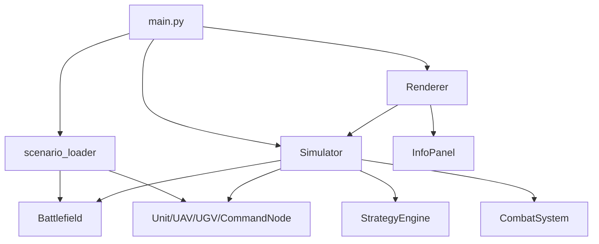
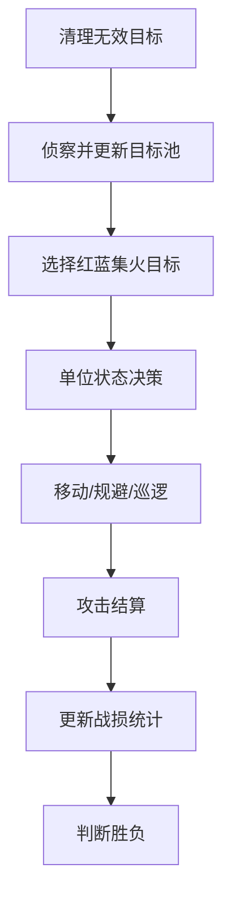
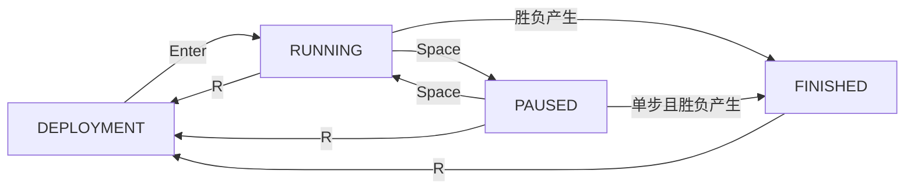

# 概要设计

## 系统总体架构

系统采用分层架构：

- `main.py`：程序入口，负责初始化、事件处理和主循环。
- `core`：核心业务逻辑，包括战场、单位、策略、战斗和仿真流程。
- `ui`：Pygame 可视化，包括地图渲染和信息面板。
- `data`：JSON 场景配置。
- `tests`：pytest 测试用例。
- `docs`：软件工程文档。

## 模块职责

- `core/battlefield.py`：地图边界、障碍物、地形和基地坐标。
- `core/entity.py`：实体基础属性和距离计算。
- `core/units.py`：统一 Unit 基类、平台类型和具体兵种。
- `core/unit_factory.py`：根据 JSON 中的 `unit_type` 创建单位。
- `core/strategy.py`：侦察、集火目标选择、巡逻、规避和撤退。
- `core/combat.py`：攻击条件、伤害结算、弹药消耗和攻击事件。
- `core/simulator.py`：统一调度每个时间步的仿真流程。
- `core/scenario_loader.py`：读取 JSON 并创建战场和单位对象。
- `core/deployment.py`：部署阶段管理，负责预设/手动部署和合法性检查。
- `ui/renderer.py`：绘制地图、基地、障碍物、单位、探测范围和攻击连线。
- `ui/panel.py`：绘制统计信息、目标池数量、集火目标和按键提示。

## 数据流说明

1. `main.py` 调用 `load_scenario()` 读取 `scenario_1.json`。
2. `scenario_loader` 创建 `Battlefield`，并通过 `UnitFactory` 创建单位列表。
3. `Simulator.step()` 按时间步更新目标池、集火目标、单位状态和战斗结果。
4. `Renderer.render()` 根据仿真状态绘制地图与信息面板。
5. 用户通过键盘控制暂停、单步、重置和退出。

## 单时间步仿真流程

1. 清理已摧毁单位和无效目标。
2. 执行侦察，更新共享目标池。
3. 每个阵营选择集火目标。
4. 每个单位进行状态决策。
5. 单位移动或规避。
6. 执行攻击结算。
7. 更新统计数据。
8. 判断胜负。

## 兵种体系模块

第三阶段将单位划分为三个平台：

- AIR：空中单位，当前包含 ScoutDrone、StrikeDrone。
- GROUND：地面单位，当前包含 GroundVehicle、MissileVehicle。
- COMMAND：指挥节点，当前包含 CommandNode。

空中单位只受地图边界约束，可以越过普通地面障碍物。地面单位不能进入障碍物，若下一步进入障碍物则停止。指挥节点速度为 0，不移动。

## UnitFactory 设计

`UnitFactory` 使用注册表维护 `unit_type` 到兵种类的映射。场景加载器只需调用 `UnitFactory.create(unit_data)`，不需要编写大量 if-else。后续新增兵种时，只需新增类并注册到 `UNIT_REGISTRY`。

## 系统状态流转

第四阶段新增系统状态：`DEPLOYMENT`、`RUNNING`、`PAUSED`、`FINISHED`。程序启动默认进入 `DEPLOYMENT`，用户可使用预设单位或手动部署单位。部署合法后按 Enter 创建 `Simulator` 并进入 `RUNNING`。运行中可暂停、单步，仿真结束进入 `FINISHED`。

