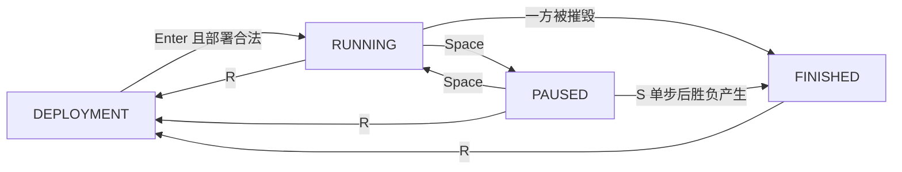

# 第四阶段功能扩展说明

## 本阶段目标

第四阶段增加仿真开始前的部署阶段。程序启动后不立即进入战斗，而是先进入 Deployment 状态，用户可以使用预设开局，也可以切换到手动部署模式自行放置单位。

## 系统状态流转

系统状态包括：

- `DEPLOYMENT`：部署阶段。
- `RUNNING`：仿真运行中。
- `PAUSED`：仿真暂停。
- `FINISHED`：仿真结束。

## 预设开局流程

1. 程序启动后读取 `data/scenario_1.json`。
2. 地图显示预设单位位置。
3. 系统状态为 `DEPLOYMENT`，部署模式为 `Preset`。
4. 用户按 `Enter` 后进入 `RUNNING`。
5. 用户按 `R` 可恢复预设开局。

## 手动部署流程

1. 部署阶段按 `M` 切换到 `Manual`。
2. 按 `1` 到 `5` 选择兵种。
3. 按 `T` 切换部署阵营 red / blue。
4. 鼠标左键点击地图区域放置单位。
5. 按 `Backspace` 撤销最近一次部署。
6. 按 `C` 清空手动部署。
7. 红蓝双方都部署单位后，按 `Enter` 开始仿真。

## DeploymentManager 设计

新增 `core/deployment.py`，其中 `DeploymentManager` 负责：

- 管理部署模式：Preset / Manual。
- 管理当前阵营和当前兵种。
- 保存手动部署单位列表。
- 保存最近一次错误或提示信息。
- 校验部署位置是否合法。
- 调用 `UnitFactory` 创建单位。
- 返回最终用于创建 `Simulator` 的单位列表。

## 部署合法性规则

- 不能部署在地图外。
- 地面单位不能部署在障碍物中。
- 指挥节点不能部署在障碍物中。
- 空中单位可以部署在障碍物上方。
- 未部署任何单位时不能开始仿真。
- 只部署一方单位时不能开始仿真。
- 红蓝双方均有单位时可以开始仿真。

## 测试说明

新增 `tests/test_deployment.py`，覆盖：

- 合法位置部署 ScoutDrone。
- 合法位置部署 GroundVehicle。
- 地面单位不能部署到障碍物。
- 空中单位可以部署到障碍物上方。
- 指挥节点不能部署到障碍物。
- 撤销和清空部署。
- 未部署、单方部署、双方部署的开始校验。

## 验收演示方法

1. 启动程序，说明当前处于 Deployment / Preset。
2. 按 `Enter` 展示预设开局可直接开始。
3. 按 `R` 返回部署阶段。
4. 按 `M` 切换 Manual。
5. 用数字键、`T` 和鼠标部署红蓝单位。
6. 演示非法部署提示。
7. 按 `Enter` 开始仿真，验证手动部署单位进入战斗。
