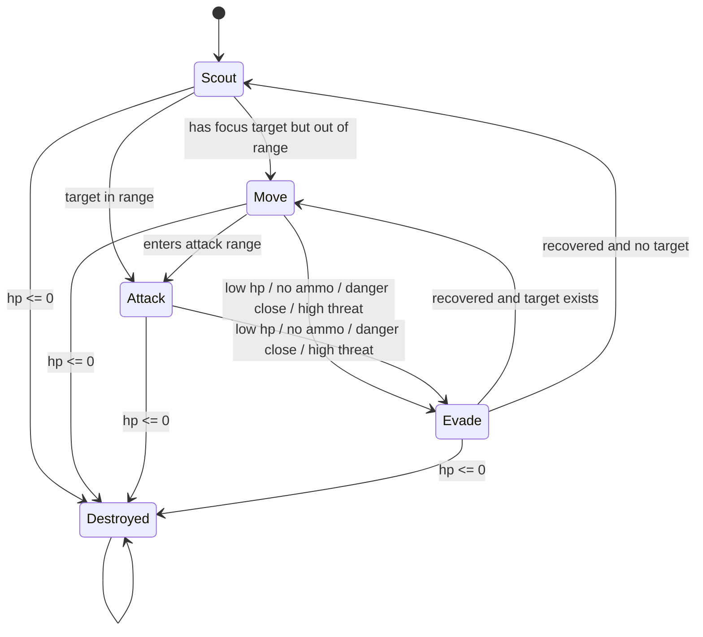
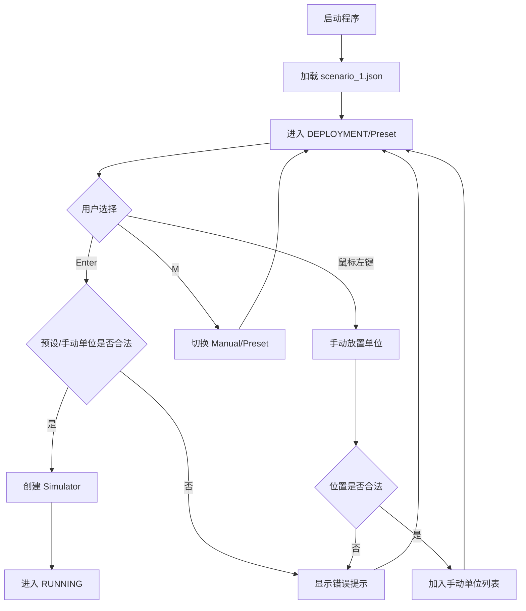
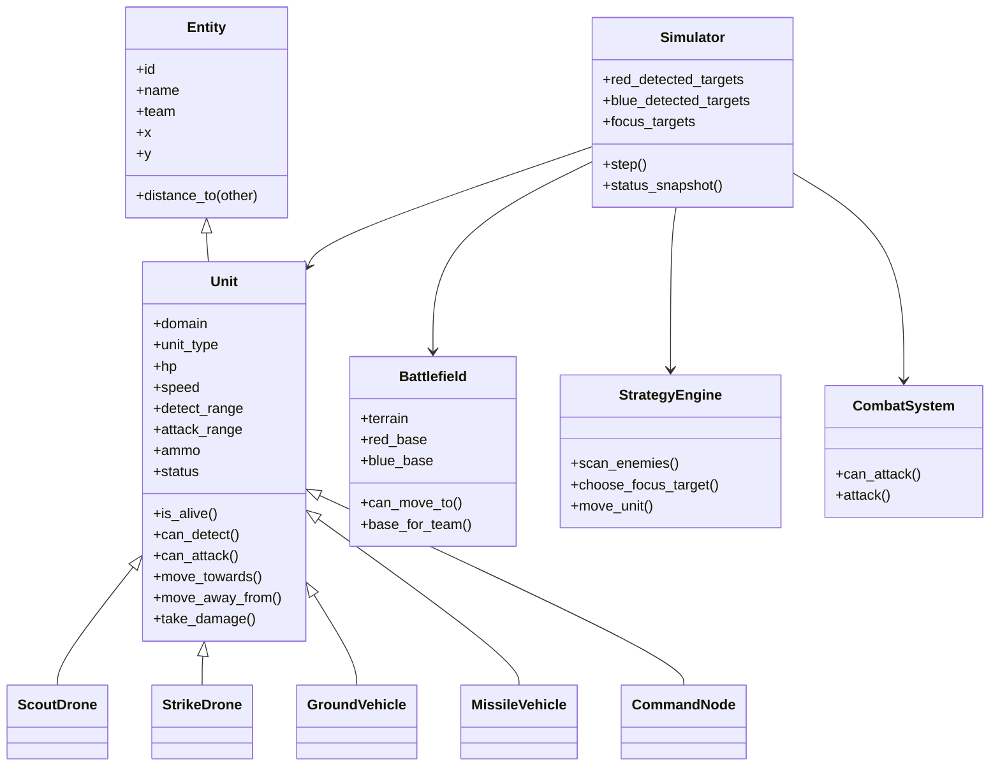
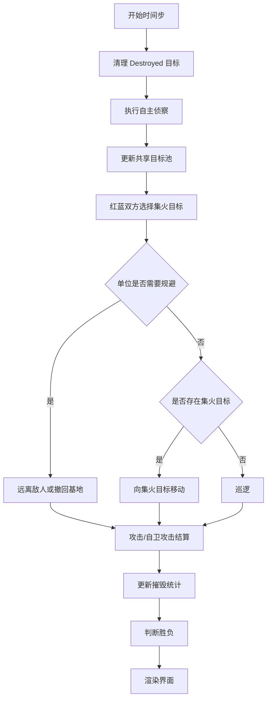

# 详细设计

## Battlefield 类设计

`Battlefield` 表示二维战场，包含宽度、高度、地形、红蓝基地和障碍物列表。

- `can_move_to(x, y)`：判断目标点是否在地图内且不在障碍物中。
- `base_for_team(team)`：返回指定阵营基地坐标。
- `Obstacle`：包含 `name`、`type`、`x`、`y`、`width`、`height`。

## Unit 类设计

`Unit` 继承 `Entity`，封装通用单位属性和移动行为。

- 属性：`id`、`name`、`team`、`domain`、`unit_type`、`x`、`y`、`hp`、`max_hp`、`speed`、`detect_range`、`attack_range`、`attack_power`、`ammo`、`status`。
- 预留能力：`can_attack_air`、`can_attack_ground`。
- 方法：`is_alive()`、`can_detect()`、`can_attack()`、`move_towards()`、`move_away_from()`、`patrol()`、`take_damage()`。
- 子类：`ScoutDrone`、`StrikeDrone`、`GroundVehicle`、`MissileVehicle`、`CommandNode`。

## 兵种类设计

- `ScoutDrone`：domain 为 air，unit_type 为 scout_drone，高速、高侦察、低攻击。
- `StrikeDrone`：domain 为 air，unit_type 为 strike_drone，中速、中攻击，适合协同打击。
- `GroundVehicle`：domain 为 ground，unit_type 为 ground_vehicle，低速、高生命、高攻击。
- `MissileVehicle`：domain 为 ground，unit_type 为 missile_vehicle，远程、高伤害、低弹药。
- `CommandNode`：domain 为 command，unit_type 为 command_node，不移动，生命值较高。

## 空地移动差异

空中单位调用 `try_move()` 时只检查地图边界，因此可以越过普通障碍物。地面单位调用 `try_move()` 时需要通过 `battlefield.can_move_to()`，不能进入障碍物。指挥节点 domain 为 command，移动方法直接返回。

## UnitFactory 设计

`core/unit_factory.py` 维护兵种注册表：

```text
scout_drone -> ScoutDrone
strike_drone -> StrikeDrone
ground_vehicle -> GroundVehicle
missile_vehicle -> MissileVehicle
command_node -> CommandNode
```

## 第六阶段：协同打击与战术规避增强

### 目标池设计

第六阶段新增 `core/target_pool.py`，用 `TargetPool` 规范红蓝双方共享目标池。`Simulator.shared_targets` 保存两个阵营的目标池，`red_detected_targets` 和 `blue_detected_targets` 作为明确命名的访问入口。

目标池中的每条记录为：

```text
TargetSighting:
    target: Unit
    last_seen_step: int
```

侦察单位在 `Simulator._reconnaissance_phase()` 中发现敌人后调用 `TargetPool.sight(target, time_step)`，首次发现写入 `[Scout]` 和 `[TargetPool]` 日志，再次发现刷新 `last_seen_step`。每个时间步调用 `cleanup()` 清理已摧毁目标和超过 `DETECTION_TIMEOUT_STEPS` 未再次发现的目标。

### 协同打击伪代码

```text
for each step:
    cleanup destroyed or stale targets
    for each active unit:
        scan enemies in detect_range
        add or refresh sightings in own team's detected_targets

    for each team:
        old_focus = focus_target
        focus_target = choose_focus_target(detected_targets, active friendly units)
        if focus changed:
            add [Focus] log

    for each active unit:
        if unit should evade:
            state = Evade
            move away from nearest enemy or retreat to base
        else if focus_target exists:
            if target in attack_range:
                state = Attack
            else:
                state = Move
                move toward focus_target according to unit role
        else:
            state = Scout or Move
            patrol / advance
```

### focus_target 选择算法

```text
function choose_focus_target(shared_targets, friendly_units):
    candidates = targets where target.status != Destroyed
    avg_position = average position of friendly_units
    sort by:
        target.hp ascending
        target.threat_value descending
        distance(target, avg_position) ascending
    return first target or None
```

威胁值配置：

| 兵种 | 威胁值 |
| --- | --- |
| ScoutDrone | 2 |
| StrikeDrone | 4 |
| GroundVehicle | 5 |
| MissileVehicle | 6 |
| CommandNode | 8 |

### 规避算法伪代码

```text
function should_evade(unit, nearest_enemy):
    if unit is Destroyed or unit.speed <= 0:
        return False

    danger_distance = max(50, nearest_enemy.attack_range * 0.5)

    if hp / max_hp < 0.3:
        return True
    if ammo == 0:
        return True
    if distance(unit, nearest_enemy) < danger_distance:
        return True
    if nearest_enemy.threat_value >= unit.threat_value + 3
       and distance(unit, nearest_enemy) <= nearest_enemy.attack_range:
        return True

    return False
```

规避移动：

```text
if visible nearest enemy exists:
    move away from nearest visible enemy
else:
    move toward own base

ground unit: try_move() checks obstacles
air unit: only map bounds are checked
```

### 状态机说明

单位状态规范为 `Scout`、`Move`、`Attack`、`Evade`、`Destroyed`。`Destroyed` 是终止状态，不参与移动和攻击。`Evade` 状态下允许近距离自卫攻击，但攻击后仍保持 `Evade`，避免自卫行为破坏状态机语义。



### UI 显示增强

右侧信息面板显示红蓝发现目标数、红蓝当前集火目标、红蓝规避单位数量和规避单位名称。地图上每个单位继续显示当前状态文字，最近日志中会出现 `[TargetPool]`、`[Focus]`、`[Evade]`、`[Attack]` 和 `[Destroyed]`。

`scenario_loader.py` 通过 `UnitFactory.create()` 创建单位。未知 `unit_type` 会抛出 `ValueError`，便于定位场景文件错误。

## DeploymentManager 类设计

`DeploymentManager` 位于 `core/deployment.py`，负责仿真开始前的部署逻辑。

主要属性：

- `mode`：部署模式，支持 preset 和 manual。
- `selected_team`：当前选择阵营。
- `selected_unit_type`：当前选择兵种。
- `manual_units`：手动部署单位列表。
- `last_message`：最近一次提示或错误信息。

主要方法：

- `toggle_mode()`：切换预设/手动部署。
- `toggle_team()`：切换 red / blue。
- `select_unit_type()`：选择当前兵种。
- `place_unit()`：检查合法性并放置单位。
- `undo()`：撤销最近一次部署。
- `clear_manual()`：清空手动部署。
- `finalize()`：校验红蓝双方单位并返回最终单位列表。

## 部署流程活动图



## Simulator 类设计

`Simulator` 维护仿真状态：

- `red_detected_targets`：红方发现目标池。
- `blue_detected_targets`：蓝方发现目标池。
- `focus_targets`：红蓝双方当前集火目标。
- `destroyed_count`：红蓝双方损失统计。
- `kill_count`：红蓝双方击毁敌方数量。
- `attack_count`：红蓝双方发起攻击次数。
- `total_damage`：红蓝双方造成的实际总伤害。
- `combat_logs`：最近 8 条战斗日志。
- `attack_events`：攻击连线特效事件。

`step()` 中集中实现单时间步流程，便于测试和答辩说明。

## CombatSystem 设计

`core/combat.py` 中的 `CombatSystem` 负责统一攻击结算，避免攻击规则分散在仿真器、策略和界面中。

主要接口：

- `can_attack(attacker, target)`：调用单位能力接口，判断攻击者、目标、弹药、射程和平台攻击能力。
- `attack(attacker, target)`：执行弹药消耗、状态切换、伤害扣除，并返回 `AttackEvent`。

`AttackEvent` 包含攻击者、目标、起点、终点、实际伤害、目标剩余生命、目标是否被摧毁和特效剩余帧数。渲染器用它绘制攻击连线和命中标记，仿真器用它累计统计。

## 侦察算法设计

```text
for each active unit:
    enemies = active enemy units
    for each enemy:
        if enemy is not Destroyed and distance(unit, enemy) <= unit.detect_range:
            add enemy to shared target pool of unit.team
            print Scout log when newly discovered
```

特点：

- 被摧毁目标不会加入目标池。
- 每个时间步清理 Destroyed 目标。
- 界面显示探测范围和发现目标数。

## 协同集火目标选择算法

```text
function choose_focus_target(shared_targets, friendly_units):
    candidates = all not destroyed shared targets
    avg_position = average position of friendly units
    sort by:
        target.hp ascending
        distance(target, avg_position) ascending
    return first target
```

该规则简单清晰，能体现“共享目标池”和“集中火力”的协同思想。

## 规避算法设计

```text
function should_evade(unit):
    if unit.speed <= 0:
        return False
    if hp / max_hp < 0.3:
        return True
    if ammo == 0:
        return True
    if nearest_enemy_distance < attack_range * 0.5:
        return True
```

```text
function evade_move(unit):
    if visible enemy exists:
        move away from nearest visible enemy
    else:
        move toward own base
```

Evade 状态下单位不会追击集火目标，但若最近敌人非常近，攻击阶段允许自卫攻击。

## 攻击结算算法

```text
function attack(attacker, target):
    if attacker is Destroyed:
        return None
    if target is Destroyed:
        return None
    if attacker.ammo <= 0:
        return None
    if distance(attacker, target) > attacker.attack_range:
        return None
    if target.domain == air and not attacker.can_attack_air:
        return None
    if target.domain in [ground, command] and not attacker.can_attack_ground:
        return None

    attacker.ammo -= 1
    attacker.status = Attack
    actual_damage = target.take_damage(attacker.attack_power)
    return AttackEvent(actual_damage, target.hp, target.is_destroyed)
```

## 胜负判断算法

本项目第五阶段采用所有单位均为有效单位的简单胜负规则，`CommandNode` 不单独作为失败条件。

```text
function judge_winner():
    red_alive = count(red units where status != Destroyed)
    blue_alive = count(blue units where status != Destroyed)

    if red_alive == 0 and blue_alive == 0:
        winner = draw
    else if red_alive == 0:
        winner = blue
    else if blue_alive == 0:
        winner = red

    if winner is set and result log not written:
        add [Result] log
```

## 可视化设计

`Renderer` 绘制地图、基地、障碍物、探测范围、攻击连线、单位图标、血条和状态文字。

`InfoPanel` 显示时间步、运行状态、剩余单位、摧毁数量、发现目标数、集火目标和胜负结果。

## Mermaid 类图



## Mermaid 活动图


