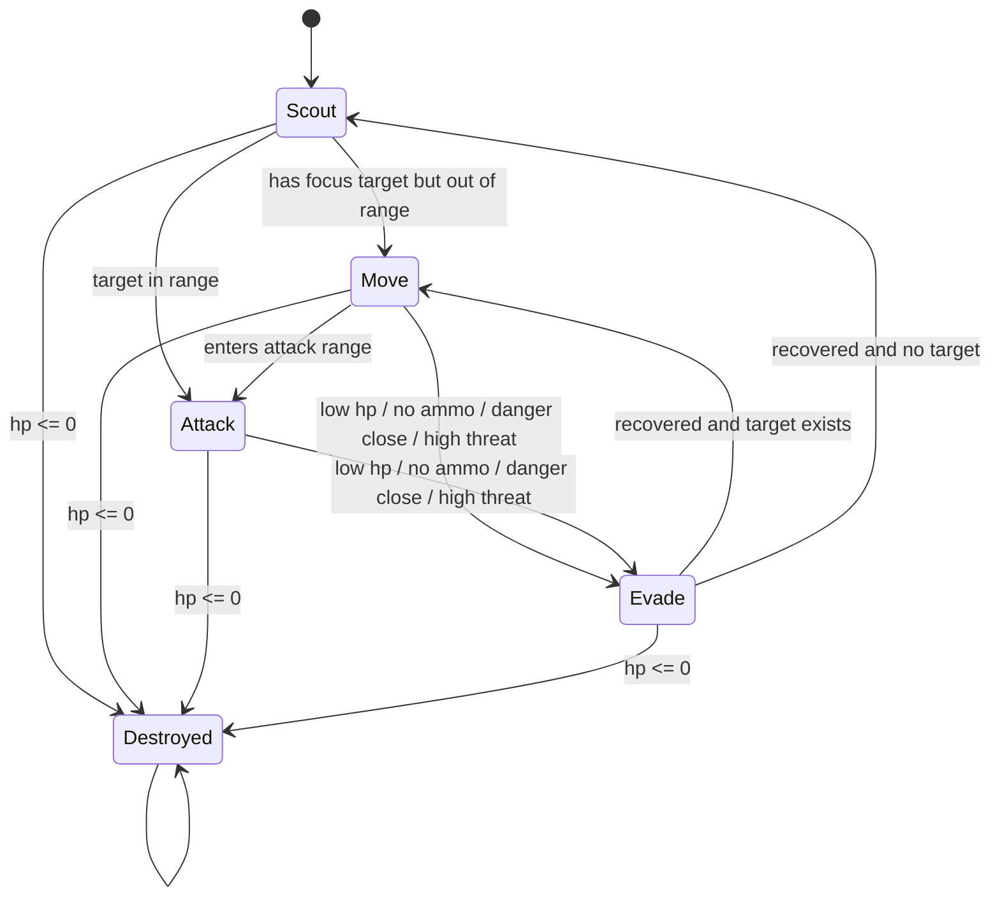
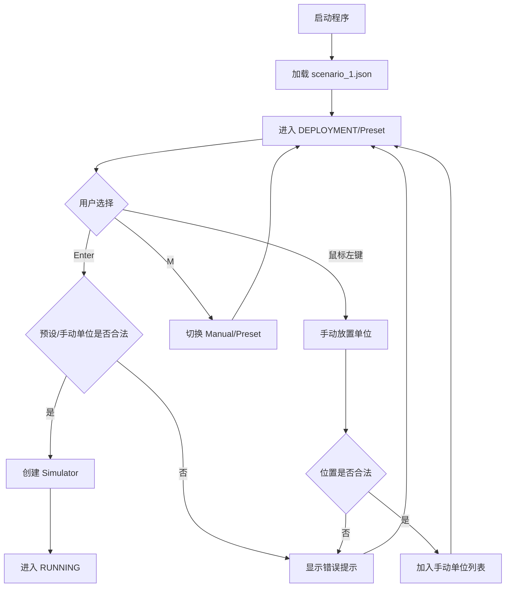
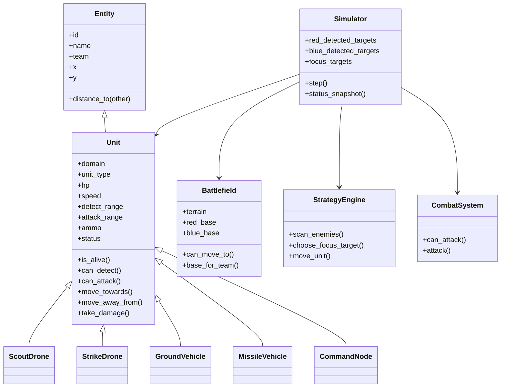
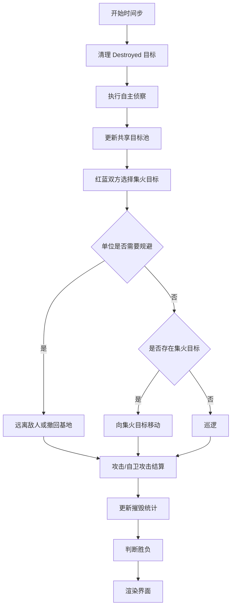
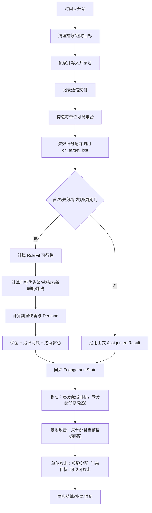

# 详细设计

## Battlefield 类设计

`Battlefield` 表示二维战场，包含宽度、高度、地形、红蓝基地和障碍物列表。

- `can_move_to(x, y)`：判断目标点是否在地图内且不在障碍物中。
- `base_for_team(team)`：返回指定阵营基地坐标。
- `Obstacle`：包含 `name`、`type`、`x`、`y`、`width`、`height`。

## Unit 类设计

`Unit` 继承 `Entity`，封装通用单位属性和移动行为。

- 属性：`id`、`name`、`team`、`domain`、`unit_type`、`x`、`y`、`hp`、`max_hp`、`speed`、`detect_range`、`attack_range`、`attack_power`、`ammo`、`status`。
- 预留能力：`can_attack_air`、`can_attack_ground`。
- 方法：`is_alive()`、`can_detect()`、`can_attack()`、`move_towards()`、`move_away_from()`、`patrol()`、`take_damage()`。
- 子类：`ScoutDrone`、`StrikeDrone`、`GroundVehicle`、`MissileVehicle`、`CommandNode`。

## 兵种类设计

- `ScoutDrone`：domain 为 air，unit_type 为 scout_drone，高速、高侦察、低攻击。
- `StrikeDrone`：domain 为 air，unit_type 为 strike_drone，中速、中攻击，适合协同打击。
- `GroundVehicle`：domain 为 ground，unit_type 为 ground_vehicle，低速、高生命、高攻击。
- `MissileVehicle`：domain 为 ground，unit_type 为 missile_vehicle，远程、高伤害、低弹药。
- `CommandNode`：domain 为 command，unit_type 为 command_node，不移动，生命值较高。

## 空地移动差异

空中单位调用 `try_move()` 时只检查地图边界，因此可以越过普通障碍物。地面单位调用 `try_move()` 时需要通过 `battlefield.can_move_to()`，不能进入障碍物。指挥节点 domain 为 command，移动方法直接返回。

## UnitFactory 设计

`core/unit_factory.py` 维护兵种注册表：

```text
scout_drone -> ScoutDrone
strike_drone -> StrikeDrone
ground_vehicle -> GroundVehicle
missile_vehicle -> MissileVehicle
command_node -> CommandNode
```

## 第六阶段：协同打击与战术规避增强

### 目标池设计

第六阶段新增 `core/target_pool.py`，用 `TargetPool` 规范红蓝双方共享目标池。`Simulator.shared_targets` 保存两个阵营的目标池，`red_detected_targets` 和 `blue_detected_targets` 作为明确命名的访问入口。

目标池中的每条记录为：

```text
TargetSighting:
    target: Unit
    last_seen_step: int
```

侦察单位在 `Simulator._reconnaissance_phase()` 中发现敌人后调用 `TargetPool.sight(target, time_step)`，首次发现写入 `[Scout]` 和 `[TargetPool]` 日志，再次发现刷新 `last_seen_step`。每个时间步调用 `cleanup()` 清理已摧毁目标和超过 `DETECTION_TIMEOUT_STEPS` 未再次发现的目标。

### 协同打击伪代码

```text
for each step:
    cleanup destroyed or stale targets
    for each active unit:
        scan enemies in detect_range
        add or refresh sightings in own team's detected_targets

    for each team:
        old_focus = focus_target
        focus_target = choose_focus_target(detected_targets, active friendly units)
        if focus changed:
            add [Focus] log

    for each active unit:
        if unit should evade:
            state = Evade
            move away from nearest enemy or retreat to base
        else if focus_target exists:
            if target in attack_range:
                state = Attack
            else:
                state = Move
                move toward focus_target according to unit role
        else:
            state = Scout or Move
            patrol / advance
```

### focus_target 选择算法

```text
function choose_focus_target(shared_targets, friendly_units):
    candidates = targets where target.status != Destroyed
    avg_position = average position of friendly_units
    sort by:
        target.hp ascending
        target.threat_value descending
        distance(target, avg_position) ascending
    return first target or None
```

威胁值配置：

| 兵种 | 威胁值 |
| --- | --- |
| ScoutDrone | 2 |
| StrikeDrone | 4 |
| GroundVehicle | 5 |
| MissileVehicle | 6 |
| CommandNode | 8 |

### 规避算法伪代码

```text
function should_evade(unit, nearest_enemy):
    if unit is Destroyed or unit.speed <= 0:
        return False

    danger_distance = max(50, nearest_enemy.attack_range * 0.5)

    if hp / max_hp < 0.3:
        return True
    if ammo == 0:
        return True
    if distance(unit, nearest_enemy) < danger_distance:
        return True
    if nearest_enemy.threat_value >= unit.threat_value + 3
       and distance(unit, nearest_enemy) <= nearest_enemy.attack_range:
        return True

    return False
```

规避移动：

```text
if visible nearest enemy exists:
    move away from nearest visible enemy
else:
    move toward own base

ground unit: try_move() checks obstacles
air unit: only map bounds are checked
```

### 状态机说明

单位状态规范为 `Scout`、`Move`、`Attack`、`Evade`、`Destroyed`。`Destroyed` 是终止状态，不参与移动和攻击。`Evade` 状态下允许近距离自卫攻击，但攻击后仍保持 `Evade`，避免自卫行为破坏状态机语义。



### UI 显示增强

右侧信息面板显示红蓝发现目标数、红蓝当前集火目标、红蓝规避单位数量和规避单位名称。地图上每个单位继续显示当前状态文字，最近日志中会出现 `[TargetPool]`、`[Focus]`、`[Evade]`、`[Attack]` 和 `[Destroyed]`。

`scenario_loader.py` 通过 `UnitFactory.create()` 创建单位。未知 `unit_type` 会抛出 `ValueError`，便于定位场景文件错误。

## DeploymentManager 类设计

`DeploymentManager` 位于 `core/deployment.py`，负责仿真开始前的部署逻辑。

主要属性：

- `mode`：部署模式，支持 preset 和 manual。
- `selected_team`：当前选择阵营。
- `selected_unit_type`：当前选择兵种。
- `manual_units`：手动部署单位列表。
- `last_message`：最近一次提示或错误信息。

主要方法：

- `toggle_mode()`：切换预设/手动部署。
- `toggle_team()`：切换 red / blue。
- `select_unit_type()`：选择当前兵种。
- `place_unit()`：检查合法性并放置单位。
- `undo()`：撤销最近一次部署。
- `clear_manual()`：清空手动部署。
- `finalize()`：校验红蓝双方单位并返回最终单位列表。

## 部署流程活动图



## Simulator 类设计

`Simulator` 维护仿真状态：

- `red_detected_targets`：红方发现目标池。
- `blue_detected_targets`：蓝方发现目标池。
- `focus_targets`：红蓝双方当前集火目标。
- `destroyed_count`：红蓝双方损失统计。
- `kill_count`：红蓝双方击毁敌方数量。
- `attack_count`：红蓝双方发起攻击次数。
- `total_damage`：红蓝双方造成的实际总伤害。
- `combat_logs`：最近 8 条战斗日志。
- `attack_events`：攻击连线特效事件。

`step()` 中集中实现单时间步流程，便于测试和答辩说明。

## CombatSystem 设计

`core/combat.py` 中的 `CombatSystem` 负责统一攻击结算，避免攻击规则分散在仿真器、策略和界面中。

主要接口：

- `can_attack(attacker, target)`：调用单位能力接口，判断攻击者、目标、弹药、射程和平台攻击能力。
- `attack(attacker, target)`：执行弹药消耗、状态切换、伤害扣除，并返回 `AttackEvent`。

`AttackEvent` 包含攻击者、目标、起点、终点、实际伤害、目标剩余生命、目标是否被摧毁和特效剩余帧数。渲染器用它绘制攻击连线和命中标记，仿真器用它累计统计。

## 侦察算法设计

```text
for each active unit:
    enemies = active enemy units
    for each enemy:
        if enemy is not Destroyed and distance(unit, enemy) <= unit.detect_range:
            add enemy to shared target pool of unit.team
            print Scout log when newly discovered
```

特点：

- 被摧毁目标不会加入目标池。
- 每个时间步清理 Destroyed 目标。
- 界面显示探测范围和发现目标数。

## 协同集火目标选择算法

```text
function choose_focus_target(shared_targets, friendly_units):
    candidates = all not destroyed shared targets
    avg_position = average position of friendly units
    sort by:
        target.hp ascending
        distance(target, avg_position) ascending
    return first target
```

该规则简单清晰，能体现“共享目标池”和“集中火力”的协同思想。

## 规避算法设计

```text
function should_evade(unit):
    if unit.speed <= 0:
        return False
    if hp / max_hp < 0.3:
        return True
    if ammo == 0:
        return True
    if nearest_enemy_distance < attack_range * 0.5:
        return True
```

```text
function evade_move(unit):
    if visible enemy exists:
        move away from nearest visible enemy
    else:
        move toward own base
```

Evade 状态下单位不会追击集火目标，但若最近敌人非常近，攻击阶段允许自卫攻击。

## 攻击结算算法

```text
function attack(attacker, target):
    if attacker is Destroyed:
        return None
    if target is Destroyed:
        return None
    if attacker.ammo <= 0:
        return None
    if distance(attacker, target) > attacker.attack_range:
        return None
    if target.domain == air and not attacker.can_attack_air:
        return None
    if target.domain in [ground, command] and not attacker.can_attack_ground:
        return None

    attacker.ammo -= 1
    attacker.status = Attack
    actual_damage = target.take_damage(attacker.attack_power)
    return AttackEvent(actual_damage, target.hp, target.is_destroyed)
```

## 胜负判断算法

本项目第五阶段采用所有单位均为有效单位的简单胜负规则，`CommandNode` 不单独作为失败条件。

```text
function judge_winner():
    red_alive = count(red units where status != Destroyed)
    blue_alive = count(blue units where status != Destroyed)

    if red_alive == 0 and blue_alive == 0:
        winner = draw
    else if red_alive == 0:
        winner = blue
    else if blue_alive == 0:
        winner = red

    if winner is set and result log not written:
        add [Result] log
```

## 可视化设计

`Renderer` 绘制地图、基地、障碍物、探测范围、攻击连线、单位图标、血条和状态文字。

`InfoPanel` 显示时间步、运行状态、剩余单位、摧毁数量、发现目标数、集火目标和胜负结果。

## Mermaid 类图



## Mermaid 活动图



## 协同动态边际拍卖（RDMA，2026-11-15）

### 目标与边界

原机制由阵营共享目标池选出一个 `focus_target`，所有可用单位向它移动和攻击。它能形成集火，但无法表达“哪个单位更适合打哪个目标”“一个目标需要几个单位”“换目标是否值得”等问题。RDMA（Role-aware Dynamic Marginal Auction）把这一步改为显式的“单位 → 目标”分配：

- 每个单位最多一个主分配目标；一个目标可被多个单位承担，但不超过 Demand 和配置上限。
- `RoleFit` 由 `unit_type × target_type` 配置驱动，`Unit.can_engage()` 是硬约束；射程只决定何时能开火，不阻止提前分配和接近。
- 未分配单位不再回退 `focus_target` 或最近敌人进行普通攻击，只执行侦察/巡逻；紧急自卫仍走原有行为逻辑。
- 基地不进入 RDMA v1 候选集，继续使用既有基地攻击通道；`focus_targets` 保留给界面和旧路径兼容。
- 同步攻击结算、`SEARCH → REACTING → ATTACK → COOLDOWN` 状态机、规避和回放/日志语义保持不变。

### 数据结构

`core/cooperative_allocator.py` 的 `AssignmentResult` 保存一次分配的完整快照：

| 字段 | 含义 |
| --- | --- |
| `assignments` | `unit_id -> target_id`，每单位最多一项 |
| `target_members` | `target_id -> [unit_id]`，按 ID 排序 |
| `primary_target_id` | 成员数最多、目标优先级最高、ID 最小的主目标 |
| `updated_step` | 本次分配对应的仿真步 |
| `assignment_since` | 每个单位当前分配的起始步，用于迟滞和日志 |
| `reasons` | `retained / switch / new`，用于可解释性 |
| `demand` | 每个目标的期望成员上限 |

`Simulator.assignments[team]` 保存两阵营最近一次结果；`_assignment_ready_step[team]` 标记“本步已经跑过 RDMA”。只有该标记等于当前步时，移动和攻击阶段才使用分配授权；直接调用旧阶段方法的兼容代码不会设置该标记，因此自动回退到旧目标选择。

### 配置

配置位于 `data/unit_config.json` 的 `cooperative_assignment`，缺省值在 `config.py` 的 `COOPERATIVE_ASSIGNMENT_DEFAULTS`。`core/unit_config_loader.py` 负责深合并、类型校验和回退；非法值发出一次 `RuntimeWarning` 后使用默认值。

| 配置 | 作用 |
| --- | --- |
| `enabled` | 是否启用 RDMA；关闭时旧目标选择逐字保留 |
| `replan_interval_steps` | 常规重规划周期 |
| `max_assignments_per_target` | 单目标成员硬上限 |
| `min_assignment_bid` | 低于该出价不分配 |
| `switch_penalty` | 旧目标仍可行时改选其他目标的出价惩罚 |
| `reassign_margin` | 迟滞换目标所需的最小收益差 |
| `overload_penalty` | 目标接近 Demand 时的边际惩罚 |
| `demand_horizon_steps` | Demand 估计的射击窗口 |
| `target_priority_weights` | 目标类型威胁与低血量权重 |
| `unit_readiness_weights` | 单位生命与弹药权重 |
| `bid_weights` | 目标优先级、RoleFit、就绪度、新鲜度、距离成本权重 |
| `role_fit` | `attacker_type -> target_type -> [0,1]` 适配矩阵 |

### RoleFit 与硬约束

对单位 `i`、目标 `j`：

```text
RoleFit(i, j) = role_fit[unit_type_i][target_type_j]
```

若 `not unit.can_engage(target)`，该单位-目标对不进入候选集，不参与出价和 Demand。`can_engage()` 只检查存活、弹药、攻击力、对空/对地域限制；`can_attack()` 在此基础上再检查距离。这样单位可以被分配到一个尚未进入射程的目标，接近后由攻击阶段按 `can_attack()` 授权。

### 出价

目标优先级：

```text
P_j = w_type * norm(threat_value_j) + w_lowHP * (1 - hp_ratio_j)
```

单位就绪度：

```text
R_i = w_health * hp_ratio_i + w_ammo * (ammo_i / max_ammo_i)
```

信息新鲜度与距离成本：

```text
F_ij = max(0, 1 - age_j / DETECTION_TIMEOUT_STEPS)
D_ij = min(1, distance(i, j) / battlefield_diagonal)
```

出价：

```text
B_ij = w_tp * P_j + w_rf * RoleFit(i, j) + w_r * R_i
     + w_f * F_ij - w_d * D_ij
     - switch_penalty * [old_target_i exists, still feasible, and != j]
```

出价只用于排序和保留/切换判断；不直接决定伤害，伤害仍由 `CombatSystem` 同步结算。

### Demand：期望伤害覆盖

对每个“单位-目标”对估计窗口内期望伤害：

```text
E_ij = p_hit(i, j, battlefield) * attack_power_i
       * (1 + CRIT_CHANCE * (CRIT_DAMAGE_MULTIPLIER - 1))
       * shots_i(H)
```

`p_hit` 直接复用 `core.combat.calculate_hit_probability()`，因此自动包含距离、速度、掩体和规避因子；暴击按期望值折算。`shots_i(H)` 从 `EngagementState` 的当前阶段和进度计算：

```text
cycle = max(1, reaction_delay + attack_cooldown + 1)

ATTACK:    ready_in = 0
REACTING:  ready_in = max(0, reaction_delay - reaction_progress)
COOLDOWN:  ready_in = max(0, attack_cooldown - cooldown_progress) + reaction_delay
SEARCH:    ready_in = reaction_delay

shots = 0                         if ready_in >= H
      = 1 + (H - 1 - ready_in)//cycle  otherwise
```

Demand 把同一目标的 `E_ij` 从大到小累加，直到覆盖 `target.hp`，再取 `max(k, MIN_ASSIGNMENT_DEMAND)`，并受 `max_assignments_per_target` 和可行单位数限制。若本窗口所有可行对的期望伤害都为 0（例如全部仍在长冷却），仍保留最低需求 1，避免“无人接单”导致分配停摆，同时不把所有单位压到同一目标上。

### 选择：保留、迟滞与边际贪心

1. **保留**：旧分配仍可行且出价不低于 `min_assignment_bid` 时，在 Demand 容量内优先保留，`reasons=retained`。
2. **迟滞换目标**：只有新目标出价比旧目标高出 `reassign_margin`，且新目标仍有容量时才切换，`reasons=switch`。
3. **贪心补充**：未分配单位按 `bid - overload_penalty * count/Demand` 的边际收益选择目标，`reasons=new`；达到 Demand 的目标不再接收新单位。
4. **清理**：最后移除低于最低出价的保留项，避免旧目标已不可行时留下幽灵分配。

所有集合按 `unit_id`、`target_id` 排序；贪心和主目标使用固定键 `(-marginal, -priority, unit_id, target_id)` 等确定性规则。输入列表顺序不同不会改变结果。

### 与交战状态机同步

分配结果写入后，`Simulator` 对每个单位执行：

- 旧目标被摧毁、超时、不可见、不可交战或单位进入 `Evade`：调用 `on_target_lost()`，反应/攻击阶段回到 `SEARCH`。
- 新分配目标与 `EngagementState.current_target_id` 不同：调用 `on_assignment_changed(new_target_id)`。
  - 旧反应进度清零，新目标从 `REACTING` 的第 0 步开始，不继承旧进度。
  - 若当前处于 `COOLDOWN`，冷却进度保留，且先清空旧目标；冷却结束后由下一次分配或正常搜索重新授权，避免换目标立即开火。
  - 反应延迟为 0 时直接进入 `ATTACK`。
- 刚同步的步不推进 `tick()`，防止新目标在同步当步就多走一格反应进度。
- 攻击阶段必须同时满足：`assigned_target_id(unit)` 存在、`EngagementState.current_target_id == assigned_target_id`、目标可见且 `can_attack()`。任一条件不满足都不开火。

### 逐单位可见性

每个单位的可见集合为：

```text
Visible_i = own_sightings_i ∪ delivered_shared_targets_team(i)
```

`own_sightings_i` 是本单位当步侦察结果；`delivered_shared_targets` 是 `TargetPool.values_available(time_step)` 中通信延迟已过的目标。分配器对每个单位单独传入该集合，绝不使用“全队所有已发现目标”的并集。未收到通信的单位不会获得队友私有侦察；目标超时后由 `TargetPool.cleanup()` 在分配前移除。

### 未分配单位与基地

RDMA 启用时：

- 已分配单位只攻击分配目标；分配目标不可见/不可攻击时保持搜索或接近，不切换到 `focus_target` 或最近敌人。
- 未分配单位只侦察/巡逻，普通攻击候选为空；基地附近的紧急自卫仍可触发，并需满足 `EngagementState.current_target_id == 基地 ID`。
- 已分配单位不参与基地攻击；基地不进入 RDMA 候选集。这样基地仍由原有通道处理，不会被分配器无意“接管”。
- 进入 `Evade` 的单位释放分配；规避期间的自卫攻击仍按旧逻辑执行。

### 流程



### 复杂度与实测

单次分配的主要开销为 `O(U × T)` 的可行对枚举、`O(U × T log(UT))` 的排序和贪心选择；本场景单位数与目标数很小，实测单次约 0.08 ms（见测试报告）。复杂度不是当前瓶颈，真正需要关注的是分配保守度与单位利用率。

### 对比实验方法

`tools/cooperative_benchmark.py` 用同一场景、同一随机种子、同一步数分别跑 Baseline（`cooperative_enabled=false`，旧 `focus_target` 路径）和 RDMA（`cooperative_enabled=true`），记录目标覆盖数、单位任务利用率、过度分配率、每百单位步切换、平均分配耗时、弹药/超杀和胜负。Baseline 的“有效目标”按每个单位自己的可见集合取 `focus_target` 或最近敌人，避免把未送达的共享侦察算进利用率。

2026-11-15 的 5 种子 × 2 场景 × ≤2000 步结果显示：RDMA 提高目标覆盖、降低目标切换、分配耗时低于 0.1 ms；但本组场景更保守、单位利用率下降，胜率没有提高，mirrored 的过度分配率反而上升。该结果说明机制已可观察、可复现，但不能作为“全面优于 Baseline”的平衡性结论。后续应在非对称编队、不同基地距离和更多种子下检查 Demand 下限、`max_assignments_per_target` 与基地攻击授权的组合。
