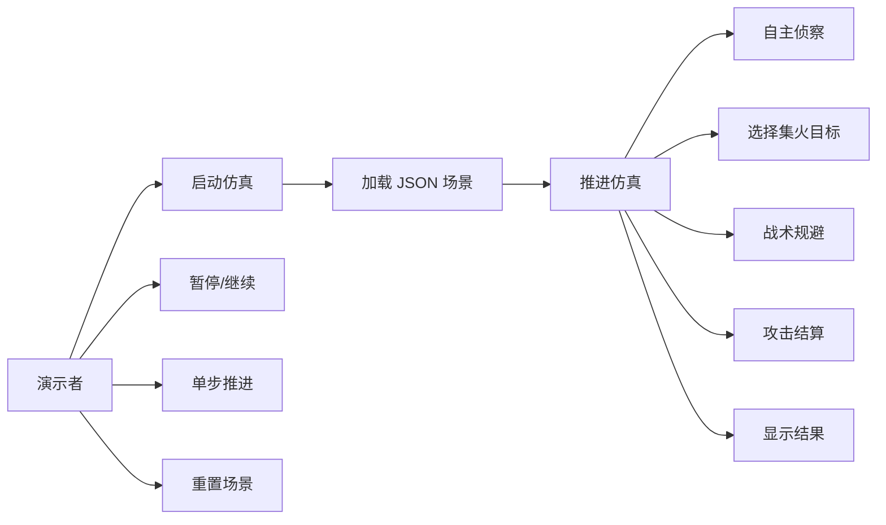

# 需求分析

## 项目背景

“无人装备战争游戏仿真系统”用于软件工程课程教学展示。系统在二维虚拟战场中抽象模拟红蓝双方无人装备对抗过程，重点展示自主侦察、协同打击、战术规避和战斗统计。

本项目不涉及真实军事参数，不追求真实武器模型，只采用可解释、可演示的抽象规则。

## 系统目标

- 构建一个可运行、可演示、可测试的二维仿真系统。
- 使用 Pygame 提供直观可视化。
- 使用面向对象方式组织战场、单位、策略、战斗和界面。
- 支持 JSON 场景配置，便于扩展不同演示场景。
- 具备完整软件工程文档和测试用例。

## 用户角色

- 学生开发者：运行、调试、扩展项目。
- 课程教师：检查需求、设计、实现、测试与演示完整性。
- 演示观众：观察无人装备对抗过程。

## 功能需求

### 战场与场景

- 地图大小默认为 800x600。
- 支持地形字段 `terrain`。
- 支持红蓝基地坐标 `red_base`、`blue_base`。
- 支持山地、建筑、禁行区域等矩形障碍物。
- 从 `data/scenario_1.json` 加载场景。

### 无人装备单位

- 支持 AIR、GROUND、COMMAND 三类平台。
- 支持 ScoutDrone、StrikeDrone、GroundVehicle、MissileVehicle、CommandNode 五类兵种。
- 单位具有编号、名称、阵营、坐标、生命、速度、探测范围、攻击范围、攻击力、弹药和状态。
- 单位具有统一接口，便于后续新增兵种。
- 状态包括 Scout、Move、Attack、Evade、Destroyed。

### 自主侦察

- 每个单位每个时间步按 `detect_range` 检测敌方单位。
- 被发现且未摧毁的敌人加入本阵营共享目标池。
- 红蓝双方目标池分别统计。
- 被摧毁目标会从目标池清理。
- 控制台输出 `[Scout]` 侦察日志。
- 界面显示探测范围圆圈和发现目标数。

### 协同打击

- 同阵营单位共享目标池。
- 每个阵营选择一个当前集火目标。
- 集火目标选择规则：生命值最低优先；生命值相同则距离己方平均位置更近者优先。
- 多个单位尽量向同一集火目标移动并攻击。
- 攻击消耗弹药并降低目标生命值。
- 控制台输出 `[Attack]` 攻击日志。
- 界面显示攻击连线和当前集火目标名称。

### 战术规避

- 移动单位在生命值低于 30%、弹药为 0 或最近敌人距离小于自身攻击范围一半时进入 Evade。
- 有可见敌人时远离最近敌人。
- 无可见敌人时向己方基地撤退。
- Evade 状态下不主动追击，但敌人过近时允许自卫攻击。
- 控制台输出 `[Evade]` 规避日志。

### 键盘交互

- 部署阶段支持预设开局和手动部署。
- 部署阶段按 Enter 开始仿真，按 M 切换预设/手动部署。
- 手动部署支持选择兵种、切换阵营、鼠标放置、撤销和清空。
- `Space`：暂停 / 继续。
- `S`：单步推进一帧。
- `R`：重置场景。
- `ESC`：退出程序。

## 非功能需求

- 可运行性：执行 `python main.py` 可启动程序。
- 可维护性：核心逻辑放在 `core`，界面放在 `ui`，数据放在 `data`。
- 可读性：关键类和方法有中文注释。
- 可测试性：使用 pytest 覆盖侦察、攻击、规避、胜负和目标池清理。
- 可扩展性：后续可增加路径规划、更多场景和更多单位类型。

## 用例说明

