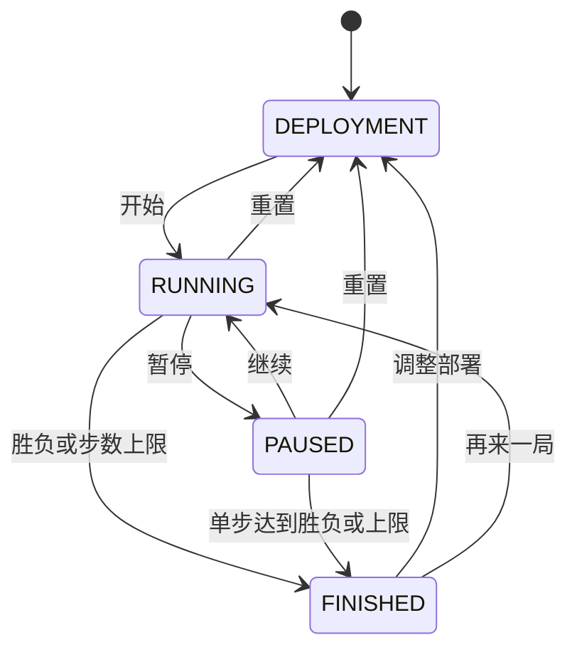

# 无人装备战争游戏仿真系统 需求分析文档

## 1. 引言

### 1.1 项目名称

无人装备战争游戏仿真系统（UAV WarGame Simulation System）

### 1.2 用户角色

| 角色 | 描述 |
|------|------|
| 课程学生 | 软件工程课程学习者和开发者，负责系统设计、编码实现、测试维护 |
| 课程教师 | 软件工程课程教学者，负责验收评估系统的功能完整性和工程质量 |
| 演示观众 | 答辩或展示时的观看者，通过可视化界面理解无人装备协同作战的抽象概念 |

### 1.3 业务需求

| 编号 | 需求 | 描述 |
|------|------|------|
| B-01 | 教学演示 | 为一个软件工程课程提供完整的项目案例，覆盖需求分析、设计、实现、测试、验收全生命周期 |
| B-02 | 仿真可视化 | 通过二维图形界面直观展示无人装备的自主侦察、协同打击、战术规避等行为，便于教学讲解 |
| B-03 | 场景可配置 | 支持 JSON 文件定义初始战场，支持界面编辑和保存，降低重复部署成本 |
| B-04 | 可测试性 | 核心逻辑与 UI 分离，支持 pytest 自动化测试，保证代码质量可量化 |
| B-05 | 可扩展性 | 模块化架构设计，新兵种、新行为、新算法可作为后续阶段增量添加 |

### 1.4 系统要解决的核心问题

| 问题 | 解决方案 |
|------|----------|
| 如何展示无人装备自主决策？ | 实现侦察→目标池→集火→规避的完整自主行为链，无需人工干预 |
| 如何体现兵种差异？ | 五类兵种各有不同属性、角色优先级和智能行为 |
| 如何避免单位撞墙/卡死？ | Bug2 绕障算法 + 卡死检测 + 角落反弹 + 8 方向巡逻队列 |
| 如何防止行为冲突？ | BehaviorManager 统一决策，每帧只执行一个最高优先级行为 |
| 如何模拟真实通信场景？ | 基于指挥节点距离的通信延迟，指挥节点被摧毁后信息共享瘫痪 |
| 如何延长战斗可观赏性？ | 基地 HP + 补给机制 + 规避冷却，避免单方面快速结束 |
| 如何消除先手优势？ | 随机反应延迟 + 同步伤害结算 + 动态命中概率，先发现方不能立即攻击 |
| 如何避免单位永不攻击？ | 多目标探测时反应进度不回退；攻击失败兜底重置为 SEARCH |
| 如何防止无意义消耗弹药？ | 基地攻击受交战状态约束，反应/冷却期不攻击基地 |

---

## 2. 项目概述

### 2.1 项目背景

本项目是软件工程课程大作业，使用 Python + PySide6/QML 实现二维无人装备对抗仿真，Pygame 保留为兼容入口。系统通过抽象规则展示自主侦察、协同集火、战术规避、战斗统计和胜负判断，不涉及真实军事参数。

### 2.2 技术栈

| 组件 | 技术 |
|------|------|
| 编程语言 | Python 3.10 |
| 图形界面 | PySide6/QML 主前端，Pygame 兼容前端 |
| 测试框架 | pytest |
| 配置格式 | JSON |
| 运行环境 | Windows，Python 虚拟环境或 PyInstaller 单文件 EXE |

---

## 3. 功能需求

### 2.1 战场与地图系统

| 编号 | 需求 | 说明 |
|------|------|------|
| F-01 | 二维战场地图 | 世界尺寸由场景 JSON 的 `map.width`、`map.height` 定义；既有场景为 800×600，新场景为 1200×800。QML 主窗口自适应，地图视口与信息面板分离；缩放和平移只改变视口，不改变世界坐标 |
| F-02 | 网格背景 | 网格随视口缩放显示，QML 支持显示开关 |
| F-03 | 矩形障碍物 | 支持山地、建筑、禁行区三种类型，定义名称、坐标、宽高 |
| F-04 | 红蓝双方基地 | 固定初始位置可拖动编辑，具有 HP（300），可被攻击和摧毁 |
| F-05 | 地形信息 | JSON 场景中定义 terrain 字段 |

### 2.2 单位与兵种系统

| 编号 | 需求 | 说明 |
|------|------|------|
| F-06 | 三类平台 | 空中（air）、地面（ground）、指挥（command） |
| F-07 | 五类兵种 | 侦察无人机、打击无人机、无人战车、导弹发射车、指挥节点 |
| F-08 | 兵种属性 | 生命值、速度、探测范围、攻击范围、攻击力、弹药量 |
| F-09 | 平台差异 | 空中单位可越过障碍物，地面单位不能进入障碍物，指挥节点不移动 |
| F-10 | 兵种工厂 | UnitFactory 根据 unit_type 创建具体兵种 |

### 2.3 部署阶段

| 编号 | 需求 | 说明 |
|------|------|------|
| F-11 | 统一部署界面 | 预设即初始状态，可直接编辑单位、障碍物和基地 |
| F-12 | 单位部署 | 按键 1-5 选择兵种，T 切换阵营，左键点击放置 |
| F-13 | 障碍物编辑 | 按键 6-8 选择类型，左键拖拽创建，拖拽把手调整大小 |
| F-14 | 对象操作 | 左键拖拽移动，右键点击删除 |
| F-15 | 基地拖动 | 左键拖拽基地标记移动位置 |
| F-16 | 部署合法性 | 单位不重叠(≥14px)、空中可越障/地面不可、不与基地过近(≥50px) |
| F-17 | 清空/恢复 | C 清空地图，R 恢复预设开局 |
| F-18 | 地图持久化 | Ctrl+S 保存（JSON格式），L 加载已保存地图 |

### 2.4 侦察与信息共享

| 编号 | 需求 | 说明 |
|------|------|------|
| F-19 | 自主侦察 | 每个单位每个时间步按 detect_range 检测敌方单位 |
| F-20 | 共享目标池 | 按阵营维护 TargetPool，存储 target + last_seen_step |
| F-21 | 通信延迟 | 信息广播延迟 = 距指挥节点距离 × 0.15 步；发现者立即可见 |
| F-22 | 指挥节点通信 | 通信枢纽，被摧毁后延迟极大(99步)，信息几乎无法共享 |
| F-23 | 目标池维护 | 摧毁目标自动清理，超时目标(DETECTION_TIMEOUT_STEPS=8)自动移除 |

### 2.5 战斗系统

| 编号 | 需求 | 说明 |
|------|------|------|
| F-24 | 攻击结算 | CombatSystem 统一处理，检查存活、弹药、射程、对空/对地能力 |
| F-25 | 协同集火 | 每个阵营选择 focus_target：高威胁值优先，同级低血量优先 |
| F-26 | 多目标优先级 | priority_targets 按威胁值降序排列，目标锁定(TARGET_LOCK_TIME=5)避免频繁切换 |
| F-27 | 攻击基地 | 单位在射程内自动攻击敌方基地，摧毁基地直接获胜 |
| F-28 | 弹药消耗 | 每次攻击消耗 1 弹药，弹药为 0 无法攻击 |
| F-56 | 同步伤害结算 | 攻击改为意图队列模式：单位攻击时生成 AttackIntent（不立即扣血），帧末统一调用 resolve_all_attacks() 批量结算，消除执行顺序导致的先手优势 |
| F-57 | 动态命中概率 | calculate_hit_probability() 综合距离因子（射程边缘衰减 20%）、目标速度因子、自身规避状态因子、掩体遮挡因子（Liang-Barsky 射线-矩形相交，系数 0.3），限制 5%~95%，暴击率 10%（伤害×1.5） |
| F-58 | 简化交战状态机 | 每单位独立维护 EngagementState：SEARCH→REACTING→ATTACK→COOLDOWN，反应延迟和攻击冷却在单位创建时从配置范围随机取值 |
| F-59 | 反先手优势 | 发现目标后需经过反应延迟（随机帧数）才能开火，先发现方无法立即攻击，被攻击方拥有反应和规避机会 |
| F-60 | 反应期目标管理 | 反应期间目标丢失则重置为 SEARCH；新目标出现不重置进度（防止多目标乒乓导致永不攻击）；冷却结束后清空 current_target_id |
| F-61 | 基地攻击约束 | 攻击基地受交战状态约束（仅 ATTACK 阶段可攻击），防止反应/冷却期无意义消耗弹药 |
| F-62 | 兵种交战属性 | 反应延迟范围、攻击冷却范围、基础命中率均可在 unit_config.json 中按兵种配置 |

### 2.6 战术行为

| 编号 | 需求 | 说明 |
|------|------|------|
| F-29 | 行为决策管理器 | BehaviorManager 统一管理，优先级：Attack(3) > Evade(2) > Scout(1) > Patrol(0) |
| F-30 | 战术规避 | 低血量(<30%)、弹药耗尽、敌人过近、高威胁敌人在附近时进入 Evade |
| F-31 | 规避冷却 | 规避退出后冷却 120 帧，超 20 帧强制退出 |
| F-32 | 路径规划 | Bug2 绕障算法，地面单位自动绕行障碍物，角落反弹逃离死循环 |
| F-33 | 卡死检测 | 连续 6 帧位移 < 3px 触发，随机偏移 + 敌方方向采样恢复 |
| F-34 | 兵种角色 | 侦察优先规避、打击猎杀高价值、地面推进、导弹保持射程 |
| F-35 | 智能补给 | 弹药=0 或血量<40% 自动向基地移动补给 |
| F-36 | 基地防御 | 敌方在基地 250px 内全员防御(最高优先级) |
| F-37 | 基地补给 | 周围 80 个世界坐标单位内友军每步恢复 4HP，每两步恢复 1 弹药；不超过生命与兵种弹药上限 |

### 2.7 态势感知

| 编号 | 需求 | 说明 |
|------|------|------|
| F-38 | 威胁评估 | threat_score() 综合基础威胁值、血量、射程、距离 |
| F-39 | 战力计算 | 攻击力×0.4 + 生命×0.4 + 弹药×0.2×10 |
| F-40 | 态势判断 | 优势(比值≥1.5)、均势(0.8≤x≤1.5)、劣势(<0.8) |
| F-41 | 战术标签 | 优势→进攻、均势→协同推进、劣势→保守推进 |

### 2.8 胜负判断

| 编号 | 需求 | 说明 |
|------|------|------|
| F-42 | 全灭胜负 | 一方全部单位被摧毁 → 对方获胜 |
| F-43 | 基地胜负 | 一方基地被摧毁 → 对方获胜 |
| F-44 | 平局 | 双方同时全灭、同时基地被毁，或达到默认 2000 步上限仍无自然胜负；自然胜负判断优先于上限结算 |

### 2.9 可视化与 UI

| 编号 | 需求 | 说明 |
|------|------|------|
| F-45 | 单位绘制 | 圆形(作战单位)/方形(指挥节点)，红蓝配色，血条和名称 |
| F-46 | 残骸显示 | 被摧毁单位灰色半透明显示，K 键切换 |
| F-47 | 探测范围 | 半透明圆圈(红/蓝) |
| F-48 | 攻击特效 | 黄色连线 + 命中十字标记，帧递减消失 |
| F-49 | 基地血条 | 基地上方绿色/红色血条 |
| F-50 | 中文界面 | 所有系统状态、单位名称、兵种名称使用中文 |
| F-51 | 态势面板 | 显示战力、态势(优势/均势/劣势)、战术、行为、基地HP |
| F-52 | 键盘操作 | Space暂停/继续、S单步、K残骸、R回部署、ESC退出 |

### 2.10 战斗统计与日志

| 编号 | 需求 | 说明 |
|------|------|------|
| F-53 | 统计数据 | 红蓝双方剩余、摧毁、攻击次数、总伤害、发现目标数、规避数 |
| F-54 | 战斗日志 | 控制台输出 [Scout]/[Attack]/[Destroyed]/[Result]/[Evade]/[TargetPool]/[Focus] |
| F-55 | 时间步 | 每步间隔 220ms（可配置） |

---

## 4. 非功能需求

### 3.1 性能要求

| 编号 | 需求 | 说明 |
|------|------|------|
| NF-01 | 界面响应 | 以流畅交互为目标；快速计算采用短批次推进，保持控制与地图导航可响应。实际桌面性能需在验收环境测量 |
| NF-02 | 仿真速度 | 每步 220ms（1x），支持 2x/4x/MAX 四档变速，支持暂停/单步 |
| NF-03 | 单位数量 | 标准对抗含 10 个单位，两个新增复杂场景各含 14 个单位；场景加载与部署规则不固定为每方 5 个单位 |

### 3.2 可维护性

| 编号 | 需求 | 说明 |
|------|------|------|
| NF-04 | 模块化架构 | core/ui/data/tests/docs 分层 |
| NF-05 | 自动测试 | pytest 覆盖核心、控制器与 QML 集成；2026-10-10 基线为 326 项通过、1 条第三方警告，证据见 [测试报告](测试报告.md) 和 [XML](verification/pytest-results.xml) |
| NF-06 | JSON 配置 | 场景可编辑、可保存、可加载 |

### 3.3 可用性

| 编号 | 需求 | 说明 |
|------|------|------|
| NF-07 | 中文界面 | 全中文显示，中文字体(Microsoft YaHei) |
| NF-08 | 输入法提示 | 部署界面提示切换英文输入法 |

---

## 5. 系统架构

### 4.1 目录结构

```
UAV_WarGame/
├── main.py                 # 程序入口
├── config.py               # 全局配置常量
├── core/
│   ├── battlefield.py      # 战场、障碍物、基地
│   ├── controller.py       # 统一工作流与状态快照
│   ├── terrain_catalog.py  # 风格、背景与归一化地标展示
│   ├── simulator.py        # 仿真流程主控
│   ├── entity.py           # 实体基础类
│   ├── units.py            # 五类兵种
│   ├── strategy.py         # AI 策略引擎
│   ├── combat.py           # 攻击结算
│   ├── target_pool.py      # 共享目标池
│   ├── scenario_loader.py  # JSON 场景加载
│   ├── unit_factory.py     # 兵种工厂
│   ├── deployment.py       # 部署管理
│   ├── obstacle_editor.py  # 地图编辑器
│   ├── map_persistence.py  # 地图保存/加载
│   ├── behavior.py         # 行为决策管理器
│   ├── threat.py           # 威胁评估与态势感知
│   ├── pathfinding.py      # Bug2 绕障算法
│   ├── engagement.py       # 交战状态机
│   └── unit_config_loader.py # 兵种配置加载器
├── ui/
│   ├── qt_app.py           # QML 主前端入口
│   ├── qt_models.py        # QML 数据与操作桥接
│   ├── qml/               # 主窗口、地图导航和对话框
│   ├── assets/maps/        # 原样复制的两张地图与来源记录
│   ├── renderer.py         # Pygame 兼容渲染器
│   └── panel.py            # Pygame 兼容信息面板
├── data/
│   ├── scenario_1.json     # 标准对抗
│   ├── scenario_obstacles.json # 障碍环境
│   ├── scenario_custom.json # 自定义场景
│   ├── scenario_valley.json # 山区河谷
│   ├── scenario_river_city.json # 河谷城镇
│   └── unit_config.json    # 兵种属性配置
├── tests/                  # 核心、控制器与前端回归测试
└── docs/                   # 课程文档
```

### 4.2 系统状态机



暂停时可单步推进；结束后“返回地图”保留结束状态，“再来一局”恢复开跑前部署后重新运行，“调整部署”回到可编辑的初始布局。

### 4.3 单位交战状态机（第十阶段新增）

```
SEARCH ──发现目标──▶ REACTING ──反应延迟达到──▶ ATTACK ──攻击成功──▶ COOLDOWN
   ▲                    │                                      │
   └────目标丢失────────┘              ◀────冷却完成────────────┘
```

- 反应延迟和冷却帧数在单位创建时从配置范围随机取值。
- 反应期间新目标出现不重置进度（防多目标乒乓）。
- 冷却结束后清空 current_target_id，重新搜索。

---

## 6. 兵种参数

### 6.1 基础战斗属性

| 属性 | 侦察无人机 | 打击无人机 | 无人战车 | 导弹发射车 | 指挥节点 |
|------|-----------|-----------|---------|-----------|---------|
| 平台 | 空中 | 空中 | 地面 | 地面 | 指挥 |
| 生命值 | 55 | 75 | 125 | 90 | 170 |
| 速度 | 4.6 | 3.5 | 2.1 | 1.7 | 0 |
| 探测范围 | 180 | 135 | 105 | 95 | 130 |
| 攻击范围 | 80 | 135 | 115 | 185 | 0 |
| 攻击力 | 8 | 18 | 26 | 34 | 0 |
| 弹药 | 6 | 7 | 10 | 4 | 0 |
| 基础威胁值 | 30 | 80 | 60 | 100 | 20 |

### 6.2 交战属性（第十阶段新增）

| 属性 | 侦察无人机 | 打击无人机 | 无人战车 | 导弹发射车 | 指挥节点 |
|------|-----------|-----------|---------|-----------|---------|
| 反应延迟（帧） | 8~15 | 15~25 | 20~35 | 30~50 | 0~0 |
| 攻击冷却（帧） | 20~35 | 30~45 | 35~50 | 45~70 | 0~0 |
| 基础命中率 | 0.70 | 0.80 | 0.75 | 0.90 | 0.0 |

---

## 7. 关键配置参数

| 参数 | 值 | 说明 |
|------|-----|------|
| SCREEN_WIDTH | 1000 | Pygame 兼容窗口默认宽度，QML 主窗口自适应 |
| MAP_WIDTH | 800 | 兼容默认世界宽度，实际使用场景 `map.width` |
| FPS | 60 | Pygame 兼容绘制目标帧率 |
| SIMULATION_INTERVAL_MS | 220 | 仿真步间隔 |
| MAX_SIMULATION_STEPS | 2000 | 教学演示上限；未发生自然胜负则结算平局 |
| MIN_UNIT_DISTANCE | 14 | 单位最小间距 |
| MIN_OBSTACLE_SIZE | 12 | 障碍物最小尺寸 |
| MIN_BASE_DISTANCE | 50 | 基地最小间距 |
| BASE_MAX_HP | 300 | 基地最大血量 |
| BASE_REPAIR_RADIUS | 80 | 基地补给半径 |
| BASE_REPAIR_PER_STEP | 4 | 每步生命恢复量 |
| COMM_DELAY_FACTOR | 0.15 | 通信延迟系数 |
| MAX_EVADE_STEPS | 20 | 规避最大帧 |
| EVADE_COOLDOWN | 120 | 规避冷却帧 |
| STUCK_THRESHOLD | 6 | 卡死检测阈值 |
| TARGET_LOCK_TIME | 5 | 目标锁定时长 |
| DETECTION_TIMEOUT_STEPS | 8 | 目标超时清理 |
| HIT_COVER_FACTOR | 0.3 | 掩体遮挡命中系数 |
| CRITICAL_CHANCE | 0.1 | 暴击概率 |
| CRITICAL_MULTIPLIER | 1.5 | 暴击伤害倍率 |
| HIT_PROB_MIN | 0.05 | 命中概率下限 |
| HIT_PROB_MAX | 0.95 | 命中概率上限 |
| DIST_DECAY_FACTOR | 0.2 | 距离命中衰减系数 |

---

## 8. 键盘操作

| 按键 | 功能 |
|------|------|
| Enter | 开始仿真 |
| 1-5 | 选择作战单位 |
| 6-8 | 选择障碍物类型 |
| T | 切换红/蓝方阵营 |
| Backspace/Delete | 撤销部署/删除 |
| C | 清空地图，QML 界面确认后执行 |
| R | 部署阶段恢复当前加载初态；运行或结束阶段返回开跑前部署 |
| Ctrl+S | 保存地图 |
| L | 加载地图 |
| Space | 暂停/继续 |
| S | 单步推进 |
| F | 切换仿真速度（1×/2×/4×/快速计算） |
| K | 切换残骸显示 |
| ESC | 退出 |

### 鼠标操作（部署阶段）

| 操作 | 功能 |
|------|------|
| 左键点击空位 | 放置当前选中的单位 |
| 左键拖拽空位 | 创建障碍物(需先选类型) |
| 左键拖拽已有对象 | 移动单位/障碍物/基地 |
| 左键拖拽障碍物右下把手 | 调整大小 |
| 右键点击 | 直接删除单位或障碍物 |

### 地图导航（QML 主界面）

| 操作 | 功能 |
|------|------|
| 地图上滚动鼠标滚轮 | 1–4 倍缩放视口 |
| 按住中键拖动 | 平移视口 |
| 放大后按住左键拖动 | 平移视口；按下即移动即平移，不改变放置与点选结果 |
| 左键按住约 0.3 秒后拖动 | 按下处已开始部署编辑时，改用平移视口 |
| 点击“− / + / 适应地图” | 缩小、放大、恢复完整地图视图 |
| 点击或拖动右下角小地图 | 定位主视图 |
| 网格 / 地标 / 全部范围开关 | 切换显示图层，仿真规则保留 |
| 部署阶段选择战术 / 山谷 / 河谷 | 改变视觉风格；运行与暂停阶段拒绝更改 |

## v1.0 课程验收版增量需求（2026-10-09）

保持现有 Python + PySide6/QML 与仿真规则，在已有章节基础上增加以下操作闭环。测试基线以本轮《测试报告》及 XML 记录为准。

| 编号 | 需求 | 验收规则 |
| --- | --- | --- |
| F-62 | 场景管理 | 标准对抗、障碍环境、空白自定义、山区河谷、河谷城镇；载入失败保留当前世界 |
| F-63 | 持久化保存 | 默认用户数据目录；原子写入；保存/另存为区分；预设只读 |
| F-64 | 单位详情 | 运行中点选、高亮，实时属性与中文状态联动 |
| F-65 | 运行控制 | 底部可见的开始/暂停/单步/直接选速；快速短批次避免阻塞 |
| F-66 | 结束结算 | 红胜、蓝胜、平局自动展示；攻击与命中分开；可导出 JSON |
| F-67 | 再次运行 | 本次开跑前部署作为重跑及修改基线，不继承受损单位和绕障缓存 |
| F-68 | 操作引导 | 首次帮助、帮助入口、清空与场景替换确认、日志分类 |
| F-69 | 有限演示时长 | 默认上限 2000 时间步；达到上限仍无自然胜负时判平局，显示结束原因；配置可调整 |
| F-70 | 验收交付 | pytest 与 QML 整合测试；Windows 单文件 EXE；操作手册与验证证据 |

即时视野每步重新计算；共享目标保持最早待交付时间，不因连续观察无限推迟；单位只使用自身视野或已交付共享信息。目标锁按配置失效，弹药补给不超过兵种配置上限。

QML 主窗口自适应，兼容前端仍保留。现实屏幕缩放、原生文件对话框及无 Python 的干净 Windows 机器需人工验收，离屏测试不替代这些检查。

## 地图扩展增量需求（2026-10-10）

| 编号 | 需求 | 验收规则 |
| --- | --- | --- |
| F-71 | 地图视觉风格 | `map.style` 接受 `tactical / valley / river`；旧文件缺失时默认 `tactical`，非法值拒绝；保存加载往返保持一致 |
| F-72 | 风格编辑阶段 | 部署阶段可选择战术、山谷、河谷；运行和暂停均拒绝更改，不更改单位与矩形障碍配置 |
| F-73 | 缩放与平移 | QML 滚轮 1–4 倍缩放、中键拖动平移、放大后左键按下即拖动平移（按下处已开始编辑时改为按住约 0.3 秒后再拖动）、− / + / 适应地图；缩放取 6 像素死区区分点击与拖动，平移增量按场景坐标计算；坐标转换保持部署、点选与障碍编辑一致；改判为平移时会放弃尚未提交的编辑手势且不放置对象；适应地图（1×）时可平移空间为零，左键手势不生效 |
| F-74 | 小地图定位 | 右下小地图展示全图与当前视口，点击或拖动定位主视图 |
| F-75 | 显示图层 | 网格、地标、全部范围可独立切换；显示切换不改变探测、攻击和碰撞规则 |
| F-76 | 复杂预设 | 保留前三个预设顺序，增加山区河谷 `valley` 与河谷城镇 `river_city`，均为 1200×800、14 单位、16 障碍；基地和地面部署合法，桥梁预留连通通道 |
| F-77 | 素材与约束边界 | 两张既有 1536×1024 原图完整复制并随程序打包；图片只展示，实际约束沿用高亮矩形与兵种规则，不迁入参考项目核心算法 |
| F-78 | 前端范围 | 地图导航面向 PySide6/QML，Pygame 兼容入口不新增导航能力 |

| 预设 | ID | `map.style` | 世界尺寸 |
| --- | --- | --- | --- |
| 标准对抗 | `standard` | `river` | 800×600 |
| 障碍环境 | `obstacles` | `valley` | 800×600 |
| 自定义场景 | `custom` | `tactical` | 800×600 |
| 山区河谷 | `valley` | `valley` | 1200×800 |
| 河谷城镇 | `river_city` | `river` | 1200×800 |

本轮新增 28 项地图测试（[后端 17 项](../tests/test_terrain_maps.py)、[界面 11 项](../tests/test_map_view_qt.py)），覆盖风格校验与往返、阶段限制、新场景合法性、独立网格洪泛桥梁连通性，以及本机离屏 Qt 鼠标和滚轮事件。源码与 EXE 各六组自检均通过，均加载五个预设，见 [源码记录](verification/source-smoke.json) 和 [打包记录](verification/package-smoke.json)。

两个新场景各以种子 42、7 运行，四次无异常，均在默认 2000 步上限结算平局，见 [运行记录](verification/map-scenario-runs.json)。该记录验证有限结束，不表示四次运行产生了自然胜负。界面示例见 [山区河谷](verification/map-valley-1280x720.png)、[河谷城镇](verification/map-river_city-1280x720.png) 与 [缩放视图](verification/map-zoom-1280x720.png)。素材细节见 [地图与素材说明](地图与素材说明.md)，人工验收范围见 [验收说明](验收说明.md)。

## 战局回放增量需求（2026-10-16）

| 编号 | 需求 | 验收规则 |
| --- | --- | --- |
| F-79 | 逐帧记录 | 运行记录格式升为版本 3，在原有 `statistics`、`units`、`logs` 之外新增 `replay` 逐帧负载与 `map` 静态地图负载；第 0 帧为部署态，帧号等于时间步；单位顺序在首帧冻结，基地作为队尾两项一并采样 |
| F-80 | 回放入口 | 结算对话框“回放本局”、“运行记录”历史行的“回放”、底部工具栏“载入回放…”三个入口都能进入回放，且都停在末帧；底部入口在部署、运行、暂停与已结束状态均可用，回放进行中隐藏 |
| F-81 | 回放控制 | 播放/暂停、单步前后、进度滑块定位、1×/2×/4×/快速变速；空格播放暂停、左右方向键单步、Esc 退出；运行记录面板、战场统计与摧毁时刻同步到游标；点击单位显示它在那一帧的属性与状态；攻击连线由该帧前后 7 步的交战记录与帧位置还原 |
| F-82 | 回放只读与阶段限制 | 回放不新建也不覆盖 `runs` 下任何记录文件；回放期间保存地图、返回部署、重新运行、载入地图与修改时间设置均被拒绝 |
| F-85 | 退出回放的位置 | 退出回放回到进入前的那份部署：从运行、暂停或已结束状态进入时是本次运行前的部署；从部署阶段进入（部署阶段可直接回放旧记录）时是当时正在编辑的布局，不退回场景初始布局 |
| F-83 | 旧记录兼容 | 版本 2 的旧记录仍可读取、导出并显示在历史列表，但标记为不可回放，历史行按钮置灰并说明原因；不做迁移或回填 |
| F-84 | 体积与有界性 | 每单位每帧 7 个 int16（位置 0.1 像素、生命、弹药、状态与交战码表下标、摧毁标志），交织后整体 base64；10 单位 2000 步原始约 274 KB，仍小于同局 `records` 块，不改变既有的内存保留与原子整文件保存约束 |
| F-86 | 归档压缩 | `runs` 下的运行记录用紧凑分隔符加 gzip 写入，读回按魔数自动识别；同一份 2000 步记录由缩进明文 8.80 MB 降到 0.282 MB（−96.8%），逐帧回放内容不变；场景另存与用户导出仍写缩进明文；明文与压缩记录可共存，版本 2 旧记录照常读取 |
| F-87 | 损坏隔离 | 归档内容损坏（含断电留下的半个 gzip 流）只影响该条记录：统一以 `ValueError` 报出，历史列表跳过它并继续显示其余对局 |

系统状态机在原有五态之外新增 `REPLAY`（回放中）与 `REPLAY_PAUSED`（回放暂停）：进入回放时不重建仿真内核。退出回放恢复到进入前的那份部署——控制器在进入时记下它（部署阶段从 `deployment.deploy_units` 取当前编辑布局，其他状态取运行前部署），因为部署阶段的 `_run_deployment` 已被“返回部署”清空，沿用旧回退路径会退回场景初始布局。回放的定量统计取游标处真值，集火目标、发现目标数、行为标签与胜负字段沿用该局最终值。

记录体积的实测结论：`records` 事件日志占 93.3%，`replay` 逐帧只占 6.6%，其中 `unit_state` 一项即占全文件约七成——所以压缩帧编码收益上限只有 6.6%，真正的体积在事件日志，归档整体压缩才是取同一条路径的收益。同一份 payload 的三种形态实测为缩进明文 8.80 MB、紧凑 6.66 MB、紧凑加 gzip 0.282 MB。压缩也要压住自动保存“整文件原子重写”的写盘量。

回放核心测试 12 项、控制器 14 项、QML 9 项、记录压缩与归档读写 5 项，全量本机运行 460 项通过、0 失败、0 跳过，证据见 [回放检查记录](verification/replay-checks.json) 与 [记录体积检查](verification/journal-size-checks.json)；源码自检增至十组。真实鼠标拖动进度滑块的连续手感、压缩在大记录上的耗时，以及无 Python 独立机器上的回放仍待人工验收，离屏事件测试不替代这几项。
